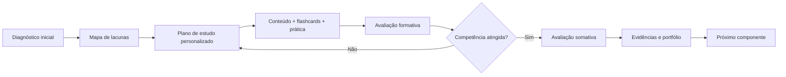
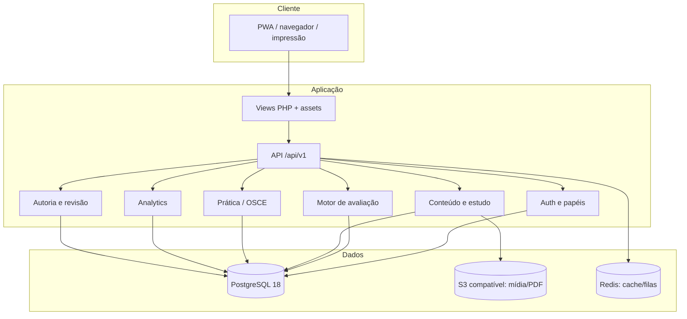
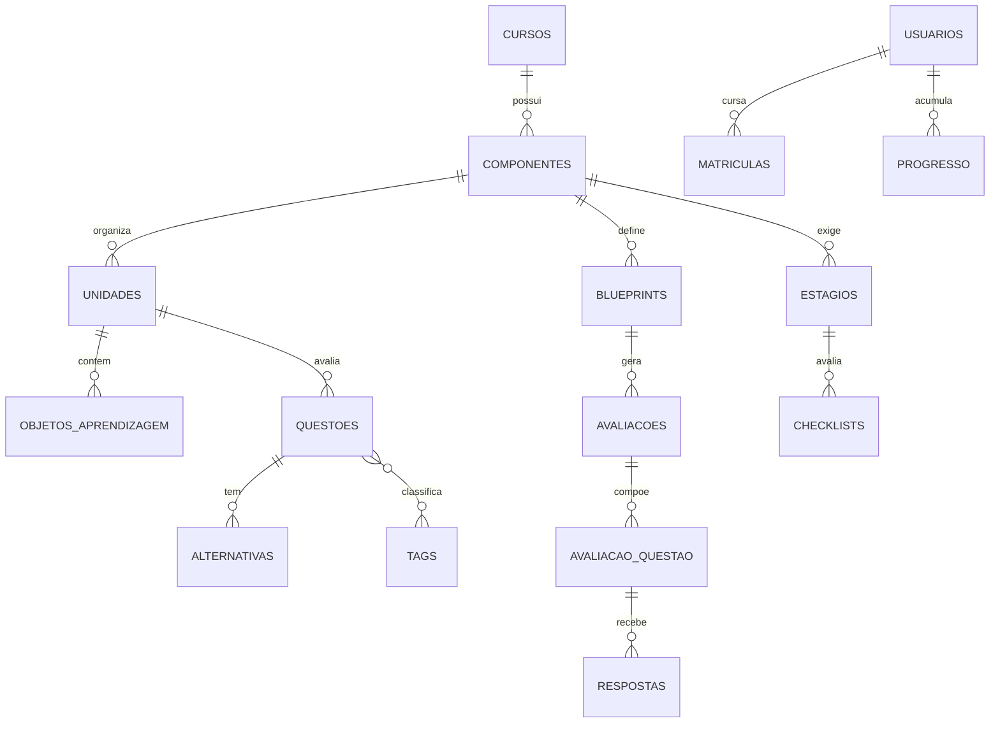

# 🧭 Plano de Expansão — Curso Técnico em Enfermagem

**Status:** draft para aprovação
**Data:** 2026-11-21 · **Revisão:** 2026-11-23
**Versão:** 1.2
**Base atual:** EN_430 — Introdução à Enfermagem (120h, 10 módulos, 2.803 questões)
**Objetivo:** planejar a reformulação total do projeto de estudos, avaliação e cobertura do curso Técnico em Enfermagem.
**Controle de progresso:** [`PROGRESSO_PLANEJAMENTO.md`](PROGRESSO_PLANEJAMENTO.md) ·
**Auditoria:** [`AUDITORIA_PLANEJAMENTO_REFORMULACAO_2026-11-23.md`](../auditorias/AUDITORIA_PLANEJAMENTO_REFORMULACAO_2026-11-23.md)

> Este documento é um **plano**, não uma implementação. As decisões de matriz curricular,
> stack e orçamento dependem de aprovação do PPC institucional e da coordenação do curso.
> O detalhamento de produto, requisitos e limites legais está no
> [PRD de apoio à formação técnica](PRD_APOIO_FORMACAO_TECNICA_ENFERMAGEM.md).

---

## 1. Sumário executivo

O projeto atual cobre **uma disciplina de 120h** do curso Técnico em Enfermagem com:

- 10 módulos de conteúdo;
- 2.803 registros de questões (495 enunciados únicos multiplicados por 5–7 variações textuais);
- 12 materiais HTML e 16 PDFs;
- aplicação PHP 8.6 + SQLite publicada em Docker/Coolify;
- 180 testes PHPUnit com 469 asserções.

O curso completo, conforme [`docs/ementa.md`](../ementa.md), tem **1.200h teórico-práticas + 600h de estágio = 1.800h**, organizado em **4 módulos e 17 componentes curriculares**. Expandir por duplicação do EN_430 seria
caro e frágil: o modelo atual tem módulo fixo (1–10), banco único, apenas múltipla escolha,
um único administrador e conteúdo sem pipeline de autoria.

**Recomendação central:** evoluir o produto atual para um **monólito modular multi-componente**
(PHP 8.6 + PostgreSQL 18), preservando histórico e investimento, com banco de questões
versionado, avaliação por blueprint, papéis de professor/coordenação, avaliações práticas
(OSCE/checklists), analytics e PWA. **Não reescrever do zero** nem migrar para outra stack
neste momento.

**Esforço estimado:** 9–12 meses, com 2–3 desenvolvedores, 1 designer/UX, QA parcial e um
time de professores-autores. O **conteúdo é o caminho crítico**, não o software.

**Meta de banco:** 4.400 itens únicos validados (contra 495 únicos hoje), com ≥30% de
questões de aplicação/análise e fim da inflação por variações textuais.

---

## 2. Base legal e curricular

| Referência | O que define |
|------------|--------------|
| **CNCT — Catálogo Nacional de Cursos Técnicos (4ª edição, Resolução CNE/CEB nº 2/2020)** | Técnico em Enfermagem no eixo **Ambiente e Saúde**, carga mínima **1.200h**, perfil profissional, infraestrutura e legislação |
| **Resolução CNE/CP nº 1/2021** | Diretrizes Curriculares Nacionais gerais da Educação Profissional e Tecnológica; organização por competências e itinerários |
| **Lei nº 7.498/1986 e Decreto nº 94.406/1987** | Regulamentação do exercício da enfermagem e atribuições do técnico, sob supervisão do enfermeiro |
| **Ementa do curso (`docs/ementa.md`)** | Matriz de referência do projeto: 4 módulos, 17 componentes, 1.200h + 600h de estágio |
| **Resolução COFEN nº 609/2019** | Registro de especialização técnica de nível médio em Enfermagem |
| **Parecer Normativo COFEN nº 001/2019** | Carga horária mínima e estágios em cursos técnicos de Enfermagem |

**Pontos que impactam o produto:**

- O estágio curricular supervisionado é obrigatório, sempre presencial, com **600h** na ementa do projeto (1.200h + 600h = 1.800h).
- Na modalidade EaD, o CNCT exige **no mínimo 50% de atividades presenciais**; no presencial,
  até 20% pode ser não presencial.
- O perfil de conclusão inclui cuidados integrais, promoção/prevenção/recuperação/reabilitação,
  biossegurança, administração de medicamentos e vacinas, curativos, sinais vitais,
  cuidados pós-morte, segurança do paciente e atuação em equipe.
- A plataforma **não substitui** estágio, laboratório de habilidades nem supervisão do enfermeiro;
  ela organiza estudo, avaliação teórica e evidências de prática.

> A matriz da seção 6 segue a **ementa do projeto** e foi cotejada com PPCs públicos (UFPI,
> IFRN, IFRS, SENAC, CPS) e com o CNCT. Deve ser substituída pela matriz oficial da instituição.

---

## 3. Diagnóstico do estado atual

### 3.1 Ativos reaproveitáveis

| Ativo | Situação | Reaproveitamento |
|-------|----------|------------------|
| Banco de 2.803 questões | 495 enunciados únicos + variações | Base inicial de Fundamentos; exige deduplicação e revisão |
| 10 módulos do EN_430 | Conteúdo de Fundamentos/Semiotécnica | Núcleo do componente "Fundamentos de Enfermagem" |
| 12 HTML + 16 PDF | Materiais didáticos maduros | Migrar para pipeline único e reutilizar |
| App PHP + SQLite | Estável, Docker/Coolify, 180 testes / 469 asserções | Evoluir, não descartar |
| Design system e UX | Paleta, componentes, fluxo de avaliação | Estender para múltiplos componentes |
| Deploy e observabilidade | Health check, volume, HTTPS | Manter e ampliar |

### 3.2 Limitações para o curso completo

| Dimensão | Limitação atual | Impacto |
|----------|-----------------|---------|
| **Domínio** | `questoes.modulo INTEGER CHECK (1..10)`; não existe entidade "componente curricular" nem "curso" | Cada novo componente exigiria schema e código novos |
| **Currículo** | Sem vínculo com competências, unidades, horas ou PPC | Impossível medir cobertura curricular real |
| **Banco de questões** | 1 enunciado → 5–7 variações por prefixo textual | Número inflado; baixa diversidade cognitiva; risco de duplicidade |
| **Tipos de item** | Apenas múltipla escolha A–D, sem mídia | Não cobre cálculo, ordenação, caso clínico, múltipla resposta |
| **Avaliação** | 20 questões aleatórias; sem blueprint, exposição controlada ou análise psicométrica | Provas desbalanceadas e sem defesa de qualidade |
| **Prática** | Nenhum suporte a estágio, OSCE, checklist ou portfólio | Metade da formação fica fora da plataforma |
| **Papéis** | Aluno + admin com senha mestra | Sem professor, preceptor, coordenação ou turmas |
| **Conteúdo** | HTML/PDF editados manualmente, sem fonte única | 17 componentes × 5 materiais = manutenção inviável |
| **Dados** | `questoes_ids`, `respostas` e `resultado` em JSON; SQLite | Consultas analíticas e integridade limitadas |
| **Privacidade** | Política v1.0, consentimento e retenção de inativas implementados; falta política por papel e regra de menores (F2, F5) | Risco LGPD no novo escopo |
| **Acessibilidade** | Sem auditoria WCAG; vídeos sem legenda | Barreira legal e pedagógica |
| **Operação** | Backup manual; sem staging; sem métricas de aplicação | Risco de perda e dificuldade de evolução |
| **Testes** | 180 testes / 469 asserções, cobertura fraca em handlers/views, sem E2E | Refatorações grandes ficam arriscadas |

### 3.3 O que **não** escalar

1. **Copiar o EN_430 16 vezes.** Gera 16 bancos, 16 apps e 16 manutenções.
2. **Multiplicar questões por prefixos.** Aumenta linhas, não competências.
3. **Modelo de "módulo 1..10".** O currículo é hierárquico e versionado.
4. **Admin único.** O curso exige autoria, revisão e coordenação por componente.
5. **Conteúdo só em HTML/PDF.** Sem fonte estruturada, não há reuso, busca ou acessibilidade.

---

## 4. Visão do produto

**Produto:** plataforma de estudo, avaliação e evidências do curso Técnico em Enfermagem,
com trilhas por componente curricular, banco de questões governado e acompanhamento de
competências.

### 4.1 Personas e necessidades

| Persona | Necessidade principal | Funcionalidades |
|---------|-----------------------|-----------------|
| **Estudante** | Saber o que estudar, praticar e medir progresso | Diagnóstico, plano semanal, flashcards, simulados, feedback, progresso por competência |
| **Professor/autor** | Criar e revisar conteúdo e itens com qualidade | Editor de itens, banco por componente, revisão por pares, blueprints, relatórios de turma |
| **Preceptor (estágio)** | Registrar prática e validar competências | Checklist/OSCE, horas, portfólio, parecer |
| **Coordenação** | Garantir cobertura do PPC e qualidade | Matriz de cobertura, analytics, relatórios, gestão de turmas |
| **Administração/TI** | Operar com segurança | Papéis, auditoria, backup, LGPD, monitoramento |

### 4.2 Jornadas principais

### 4.3 Escopo

**Fase 1 (12 meses):**

- 17 componentes curriculares + estágio de 600h;
- banco de questões versionado e multi-tipo;
- diagnóstico, avaliação formativa e somativa;
- plano de estudos e repetição espaçada;
- papéis de aluno, professor, coordenação e admin;
- analytics de aprendizagem e qualidade de itens;
- suporte a OSCE/checklists de estágio;
- PWA responsiva e acessível.

**Fora de escopo (fase 1):** certificação oficial, pagamentos, app nativo, marketplace,
IA generativa autônoma, multi-instituição.

---

## 5. Arquitetura-alvo

### 5.1 Princípios

- **Monólito modular** com fronteiras por domínio (currículo, conteúdo, avaliação, prática, analytics).
- **API-first** (`/api/v1` + OpenAPI) para permitir PWA e futuras integrações.
- **Banco relacional** para integridade e analytics; SQLite apenas em desenvolvimento/teste.
- **Conteúdo como código** (fonte estruturada versionada) e build reproduzível.
- **Privacidade por padrão** (LGPD) e **acessibilidade WCAG 2.2 AA**.
- **YAGNI/KISS:** complexidade só quando houver requisito e medição.

### 5.2 Opções avaliadas

| Opção | Vantagens | Riscos | Veredito |
|-------|-----------|--------|----------|
| **A. Evoluir PHP para monólito modular + PostgreSQL** | Preserva código, equipe, deploy e histórico; menor risco | Exige refatoração de handlers e schema | ✅ **Recomendada** |
| **B. Reescrever em FastAPI + React/Next** | Stack moderna; bom para IA | Descarta investimento; nova operação; prazo maior | ⏳ Avaliar somente se houver equipe Python dedicada |
| **C. Adotar Moodle/LMS** | Questões, papéis, notas e relatórios prontos | UX datada; customização pesada; perde o fluxo atual | ⏳ Só se a instituição padronizar LMS para todos os cursos |

**Decisão sugerida:** opção A, com ADR registrando a escolha e critérios de revisão.
O projeto `aprendizado_em_ia` continua como base de apoio, **não** como backend do produto.

### 5.3 Componentes da solução

### 5.4 Modelo de dados (núcleo)

| Entidade | Campos-chave |
|----------|--------------|
| `cursos` | id, nome, eixo, carga_horaria, versao_ppc, ativo |
| `componentes_curriculares` | id, curso_id, codigo, nome, carga_horaria, periodo, ementa |
| `unidades` | id, componente_id, ordem, titulo, objetivos, horas |
| `objetos_aprendizagem` | id, unidade_id, tipo (leitura/vídeo/caso/flashcard), titulo, midia_id, horas |
| `questoes` | id, unidade_id, tipo, enunciado, dificuldade, bloom, competencia, status, versao, autor_id, revisor_id |
| `alternativas` | id, questao_id, texto, correta, feedback |
| `blueprints` | id, componente_id, regras (distribuição por unidade/dificuldade/bloom) |
| `avaliacoes` | id, estudante_id, blueprint_id, tipo, status, nota, tentativa, iniciada_em, finalizada_em |
| `avaliacao_questao` | avaliacao_id, questao_id, ordem, pontos (substitui JSON `questoes_ids`) |
| `respostas` | id, avaliacao_questao_id, alternativa_id, correta, tempo |
| `progresso` | estudante_id, unidade_id, dominio, ultima_atividade |
| `matriculas` / `turmas` / `papeis` | vínculo do estudante, professor e coordenação |
| `estagios` / `checklists` | horas, competências, evidências, parecer |
| `auditoria` | ator, ação, entidade, antes/depois, data (LGPD) |

**Migração do atual:** `questoes.modulo` → componente EN_430 + unidades 1–10;
`avaliacoes.questoes_ids` (JSON) → `avaliacao_questao`; `respostas`/`resultado` (JSON) →
`respostas`; `estudantes` → `usuarios` + `matriculas`; admin → papel `admin`.
Histórico e IDs preservados; migração idempotente e com relatório de reconciliação.

### 5.5 Avaliação

| Tipo | Uso | Formato |
|------|-----|---------|
| **Diagnóstico** | Mapear lacunas na entrada do componente | 20–30 itens por competência |
| **Formativa** | Praticar por unidade, feedback imediato | 5–10 itens + explicação |
| **Somativa** | Fechar componente | 30–40 itens por blueprint |
| **Simulado** | Preparar para provas | 60–100 itens, tempo cronometrado |
| **Prática/OSCE** | Validar técnica e comunicação | Checklist com rubrica e preceptor |
| **Portfólio** | Evidências de estágio | Relatos, fotos, horas, parecer |

**Qualidade de itens:** dificuldade (p-value), discriminação, exposição, revisão por pares,
versionamento, aposentadoria de itens ruins; cálculo de confiabilidade (KR-20) por prova.
**Anti-fraude:** banco embaralhado por blueprint, limite de tentativas, detecção de padrão,
revisão humana de denúncias. Não usar vigilância invasiva.

### 5.6 Conteúdo e estudo

- Fonte única por componente: `conteudo/<componente>/` em Markdown/MDX com metadados
  (competência, unidade, carga, referências).
- Pipeline de build gera HTML acessível e PDF; o app consome os mesmos artefatos.
- Vídeos com legenda e transcrição; imagens com alt; tabelas responsivas.
- Plano de estudo: diagnóstico → lacunas → agenda semanal → repetição espaçada (SM-2) →
  flashcards e casos clínicos.
- PWA: instalação, cache de conteúdo já visitado, fila offline para respostas.

### 5.7 Segurança e LGPD

- Base legal e finalidade por dado; consentimento para comunicações; retenção definida.
- Direitos do titular: exportação, correção e exclusão/anonimização.
- Dados sensíveis de saúde **não** devem ser coletados no ambiente de estudo; casos clínicos
  são fictícios.
- Papéis com menor privilégio; 2FA para staff; auditoria de acessos.
- OWASP ASVS, CSP, rate limit, backups criptografados e teste de restauração.
- Política de uso de IA: geração de rascunhos com revisão humana obrigatória; nunca usar
  dados de estudantes em provedores externos sem base legal.

### 5.8 Operação

| Área | Decisão |
|------|---------|
| Banco | PostgreSQL 18 gerenciado ou container com volume + backup externo |
| Deploy | Docker + Coolify, ambientes `staging` e `production` |
| Mídia | S3 compatível (MinIO/Spaces) para vídeos, imagens e PDFs |
| Cache/filas | Redis para sessões, cache e jobs (e-mails, relatórios) |
| CI/CD | GitHub Actions: lint, testes, build, migração, smoke test |
| Observabilidade | Logs estruturados, métricas, uptime, alertas |
| Backups | Diário + retenção 30 dias + teste mensal de restauração |

---

## 6. Matriz de cobertura curricular

**Fonte curricular:** [`../ementa.md`](../ementa.md) — **1.200h teórico-práticas + 600h de
estágio supervisionado = 1.800h**, organizadas em **4 módulos e 17 componentes**.

A distribuição de horas por componente abaixo é uma **proposta de rateio** para fins de
planejamento. O PPC institucional e a carga horária oficial de cada componente prevalecem.

**Legenda de cobertura atual:** 🟢 reaproveitável · 🟡 parcial · 🔴 inexistente.
**Itens-alvo:** itens **únicos e validados**, não variações textuais.

### 6.1 Módulo I — Fundamentos Básicos e Saúde Coletiva (300h)

| # | Componente curricular | CH prop. | Cobertura | Itens-alvo | Materiais | Prática | Prioridade |
|:-:|------------------------|:--------:|:---------:|:----------:|:---------:|:-------:|:----------:|
| 1 | Anatomia e Fisiologia Humana | 60h | 🟡 | 300 | 6 | Laboratório | Alta |
| 2 | Microbiologia e Parasitologia | 45h | 🔴 | 200 | 4 | Laboratório | Média |
| 3 | Biossegurança e Controle de Infecção (CCIH) | 45h | 🟡 | 200 | 4 | Laboratório | Alta |
| 4 | Políticas Públicas de Saúde e SUS | 50h | 🔴 | 250 | 5 | UBS | Alta |
| 5 | Ética, Bioética e Legislação | 50h | 🟡 | 200 | 4 | — | Alta |
| 6 | Psicologia Aplicada à Saúde e Humanização | 50h | 🔴 | 200 | 3 | — | Média |
| | **Subtotal** | **300h** | — | **1.350** | **26** | — | — |

### 6.2 Módulo II — Bases Técnicas e Assistência Clínica Geral (330h)

| # | Componente curricular | CH prop. | Cobertura | Itens-alvo | Materiais | Prática | Prioridade |
|:-:|------------------------|:--------:|:---------:|:----------:|:---------:|:-------:|:----------:|
| 7 | Fundamentos e Semiotécnica de Enfermagem | 120h | 🟢 | 400 | 10 | Lab. + estágio | Alta |
| 8 | Farmacologia e Cálculo de Medicamentos | 70h | 🟡 | 300 | 5 | Laboratório | Alta |
| 9 | Nutrição e Dietética | 40h | 🔴 | 150 | 3 | — | Média |
| 10 | Enfermagem em Clínica Médica | 100h | 🔴 | 350 | 7 | Estágio | Alta |
| | **Subtotal** | **330h** | — | **1.200** | **25** | — | — |

### 6.3 Módulo III — Assistência Cirúrgica e Ciclos de Vida (330h)

| # | Componente curricular | CH prop. | Cobertura | Itens-alvo | Materiais | Prática | Prioridade |
|:-:|------------------------|:--------:|:---------:|:----------:|:---------:|:-------:|:----------:|
| 11 | Clínica Cirúrgica, Centro Cirúrgico e CME | 90h | 🔴 | 300 | 6 | Lab. + estágio | Alta |
| 12 | Saúde da Mulher (Ginecologia e Obstetrícia) | 80h | 🔴 | 300 | 6 | Estágio | Média |
| 13 | Saúde da Criança, Adolescente e Neonatologia | 90h | 🔴 | 350 | 7 | Estágio | Média |
| 14 | Saúde do Idoso (Gerontologia e Geriatria) | 70h | 🟡 | 200 | 4 | Estágio | Média |
| | **Subtotal** | **330h** | — | **1.150** | **23** | — | — |

### 6.4 Módulo IV — Alta Complexidade, Urgência e Saúde Mental (240h)

| # | Componente curricular | CH prop. | Cobertura | Itens-alvo | Materiais | Prática | Prioridade |
|:-:|------------------------|:--------:|:---------:|:----------:|:---------:|:-------:|:----------:|
| 15 | Urgência e Emergência (SBV/SAV, PCR, Manchester) | 90h | 🔴 | 250 | 5 | Laboratório | Alta |
| 16 | Unidade de Terapia Intensiva (UTI) | 80h | 🔴 | 200 | 5 | Estágio | Média |
| 17 | Saúde Mental e Psiquiatria | 70h | 🔴 | 250 | 4 | CAPS | Média |
| | **Subtotal** | **240h** | — | **700** | **14** | — | — |

### 6.5 Estágio Curricular Supervisionado (600h)

| Campo de estágio | Atividades principais | Evidências |
|------------------|-----------------------|------------|
| Atenção Primária (UBS/ESF) | Triagem, vacinação, curativos, visitas domiciliares, grupos educativos | Checklist + horas + relato |
| Clínica Médica e Cirúrgica | Medicamentos, SSVV, sondas/drenos, higiene, curativos, evolução | Checklist + portfólio |
| Saúde Materno-Infantil | Alojamento conjunto, berçário, pediatria, sala de parto, amamentação | Checklist + OSCE |
| Urgência, Emergência e UTI | Pronto-socorro, sala vermelha, monitorização, apoio a procedimentos | Checklist + OSCE |

**Meta:** 150 evidências/checklists cobrindo os quatro campos, com rubrica e validação por
preceptor. O estágio **não** é avaliado por múltipla escolha.

**Totais do curso:** 1.200h teórico-práticas + 600h de estágio (1.800h), **17 componentes**,
**88 materiais** e **4.400 itens-alvo**.

### 6.6 Leitura da matriz

- **Fundamentos e Semiotécnica** é o único componente majoritariamente pronto; ainda precisa
  de deduplicação dos 2.803 registros para ~495 itens únicos e revisão pedagógica.
- **Anatomia, Biossegurança, Ética, Farmacologia e Saúde do Idoso** têm conteúdo parcial
  reaproveitável dos módulos atuais (3, 6, 10, 4–5 e 9), totalizando **5 componentes parciais**.
- **11 dos 17 componentes** não têm conteúdo nem banco: Microbiologia, SUS, Psicologia,
  Nutrição, Clínica Médica, Cirúrgica/CME, Saúde da Mulher, Criança/Neonato, Urgência,
  UTI e Saúde Mental.
- O **estágio de 600h** exige suporte próprio (horas, checklists, portfólio, preceptor),
  não questões objetivas.
- A ementa define **4 módulos progressivos**; a plataforma deve refletir essa progressão
  (pré-requisitos, trilhas e liberação por período).

### 6.7 Meta de banco de questões

| Métrica | Hoje | Meta |
|---------|-----:|-----:|
| Registros | 2.803 | 4.400+ |
| Enunciados únicos | ~495 | 4.400 |
| Duplicidade por variação | ~82% | < 5% |
| Itens de aplicação/análise | baixa | ≥ 30% |
| Itens com mídia/caso clínico | 0 | ≥ 20% |
| Itens revisados por pares | 0 | 100% |
| Itens com análise psicométrica | 0 | 100% dos aplicados |

**Esforço autoral estimado:** 1.800–2.600 horas de professor/autor + revisão, distribuídas
em 9–12 meses (≈ 8 professores a 10h/semana). Sem esse time, o roadmap não fecha.

### 6.8 Blueprints de avaliação

| Componente / grupo | Diagnóstico | Formativa | Somativa | Simulado |
|--------------------|:-----------:|:---------:|:--------:|:--------:|
| Fundamentos e Semiotécnica | 30 | 5–10/unidade | 40 | 80 |
| Anatomia e Fisiologia | 25 | 5–10/unidade | 35 | 60 |
| Farmacologia e Cálculo | 25 | 5–10/unidade | 35 | 60 |
| Biossegurança / CCIH | 20 | 5–10/unidade | 30 | 60 |
| SUS / Saúde Coletiva | 25 | 5–10/unidade | 35 | 60 |
| Clínica Médica | 30 | 5–10/unidade | 40 | 80 |
| Cirúrgica / CME | 25 | 5–10/unidade | 35 | 60 |
| Saúde da Mulher / Criança | 25 | 5–10/unidade | 35 | 60 |
| Urgência / UTI / Saúde Mental | 25 | 5–10/unidade | 35 | 60 |
| Estágio | — | checklist por procedimento | OSCE | portfólio |

Distribuição-alvo por prova: 40% recordação/compreensão, 40% aplicação, 20% análise/avaliação.

---

## 7. Roadmap

### 7.1 Visão por fases

> **Escopo e prazos de release:** fonte única em
> [`PROGRESSO_PLANEJAMENTO.md`](PROGRESSO_PLANEJAMENTO.md) §6 (44 semanas, MVP de 4 componentes).
> Esta seção descreve o **trabalho de engenharia** de cada release, não um roadmap paralelo.

| Release | Trabalho de engenharia | Critério técnico |
|:-------:|------------------------|------------------|
| **Fundação** | ADR de stack, baseline, hardening, CI, taxonomia técnica e templates | Pipeline e ADR aprovados |
| **MVP** | PostgreSQL, migrations, modelo de domínio, papéis, migração do EN_430, blueprints, CI/CD | Dados migrados e reconciliação 100% |
| **R1** | Checklists de estágio, analytics, SSO opcional e psicometria inicial | 2 campos de estágio operando |
| **R2** | OSCE/portfólio, repetição adaptativa, IA com guardrails, Libras e relatórios completos | 17 componentes cobertos |
| **Operação** | Norm watch, revisão de schemas, escala e sustentação | Revisão semestral registrada |

**Duração total:** 4 + 12 + 12 + 16 = **44 semanas (~11 meses)**, conforme a tabela única.
Com 4 desenvolvedores em paralelo e time autoral completo, pode reduzir para 7–8 meses; com
1 desenvolvedor, ultrapassa 18 meses.

### 7.2 Cronograma

As janelas de cada release são as da tabela única (`PROGRESSO_PLANEJAMENTO.md` §6), derivadas do
G0 assinado. O Gantt anterior, que iniciava em 2026-12-01 sem G0 aprovado, foi removido para não
criar um segundo cronograma (achados A3 e H4).

### 7.3 Equipe e esforço

| Papel | Alocação | Esforço |
|-------|----------|---------|
| Tech lead / arquiteto | 50% | 6 pessoa-mês |
| Desenvolvedor backend | 100% | 11 pessoa-mês |
| Desenvolvedor frontend/PWA | 100% | 9 pessoa-mês |
| Designer/UX + acessibilidade | 60% | 7 pessoa-mês |
| QA / automação | 40% | 4 pessoa-mês |
| Professores-autores e revisores | 8 × 10h/semana | 1.800–2.600h |
| Coordenação pedagógica | 20% | 3 pessoa-mês |

**Custo:** varia por região e modelo de contratação; o plano recomenda orçar por
pessoa-mês e separar o custo autoral (o mais alto e o mais crítico).

---

## 8. Backlog inicial (épicos)

| ID | Épico | Resultado |
|----|-------|-----------|
| E1 | Domínio multi-componente | Curso, componente, unidade e versão do PPC modelados |
| E2 | Migração e continuidade | EN_430 migrado sem perda de histórico; rollback testado |
| E3 | Banco de questões v2 | Itens únicos, multi-tipo, mídia, tags, versionamento |
| E4 | Autoria e revisão | Fluxo autor → revisor → publicado, com trilha de auditoria |
| E5 | Motor de avaliação | Blueprints, sorteio, correção, tentativas, feedback |
| E6 | Papéis e turmas | Aluno, professor, preceptor, coordenação, admin |
| E7 | Conteúdo e plano de estudo | Pipeline Markdown/PDF, trilhas, flashcards, repetição espaçada |
| E8 | Analytics | Progresso por competência, qualidade de itens, relatórios de turma |
| E9 | Prática e estágio | Checklists, OSCE, horas, portfólio e parecer |
| E10 | PWA e acessibilidade | Instalação, offline, WCAG 2.2 AA, legendas |
| E11 | LGPD e segurança | Consentimento, retenção, exportação, exclusão, auditoria |
| E12 | Operação e CI/CD | Staging, migrações, backups testados, métricas e alertas |

**Histórias de exemplo (critérios de aceite):**

- **E1.1** Como coordenação, quero cadastrar componentes com carga horária e competências
  para que a matriz do PPC seja a fonte de verdade.
  *Aceite:* CRUD, validação de horas, versionamento e vínculo com unidades.
- **E3.1** Como professor, quero criar um item com dificuldade, Bloom e competência
  para reutilizá-lo em provas.
  *Aceite:* campos obrigatórios, mídia opcional, revisão antes de publicar.
- **E5.1** Como professor, quero gerar uma prova por blueprint
  para garantir cobertura equilibrada.
  *Aceite:* distribuição configurável, nenhuma unidade sem item, resultado auditável.
- **E9.1** Como preceptor, quero registrar um checklist de procedimento
  para validar a prática do estudante.
  *Aceite:* rubrica, assinatura, horas, evidência e parecer.
- **E11.1** Como titular, quero exportar e excluir meus dados
  para exercer direitos da LGPD.
  *Aceite:* Fluxo autenticado, prazo, registro de auditoria.

---

## 9. KPIs e critérios de sucesso

| Categoria | KPI | Meta |
|-----------|-----|------|
| Cobertura | Componentes com conteúdo e banco | 100% |
| Cobertura | Unidades com ≥ 20 itens únicos | 100% |
| Qualidade | Itens duplicados/variações | < 5% |
| Qualidade | Itens revisados por pares | 100% |
| Qualidade | Confiabilidade da prova (KR-20) | ≥ 0,70 |
| Aprendizagem | Ganho pré/pós por componente | ≥ 20 p.p. |
| Aprendizagem | Taxa de aprovação | ≥ 70% |
| Engajamento | Estudantes ativos semanais | ≥ 60% da turma |
| Produto | Conclusão de módulo/componente | ≥ 70% |
| Acessibilidade | Critérios WCAG 2.2 AA | 100% das telas críticas |
| Operação | Uptime | ≥ 99,5% |
| Operação | p95 de páginas críticas | ≤ 2 s |
| Operação | Teste de restauração de backup | Mensal, 100% sucesso |
| Privacidade | Incidentes LGPD | 0 |

---

## 10. Riscos e mitigação

| Risco | Prob. | Impacto | Mitigação |
|-------|:-----:|:-------:|-----------|
| Conteúdo autoral não acompanhar o software | Alta | Alto | Contratar/liberar professores antes da fase 2; metas semanais por componente |
| Matriz curricular divergir do PPC | Média | Alto | Validar a matriz na fase 0 com coordenação e conselho |
| Itens de baixa qualidade psicométrica | Média | Alto | Revisão por pares, pré-teste, análise e aposentadoria de itens |
| Escopo crescer para "LMS completo" | Alta | Médio | Fora de escopo explícito; revisão mensal do backlog |
| LGPD e dados de saúde | Média | Alto | Minimização, casos fictícios, DPO, política de retenção |
| IA gerar conteúdo incorreto | Média | Alto | Revisão humana obrigatória e fontes citadas |
| Dependência de uma pessoa | Média | Alto | Documentação, pareamento, CI e ADRs |
| Custo acima do previsto | Média | Médio | Fases com critérios de saída; parar/replanejar entre fases |
| Baixa adoção de alunos/professores | Média | Médio | Piloto, treinamento, UX e suporte |
| Convênios e campos de estágio insuficientes para 600h | Média | Alto | Mapear campos na fase 0; acordo com UBS/hospitais; plano B por componente |

---

## 11. Migração e continuidade

1. **Congelar** o schema atual e criar backup verificado.
2. Criar `curso EN_430` e `componente Fundamentos` a partir dos 10 módulos.
3. Migrar questões, alternativas e histórico; gerar relatório de reconciliação
   (contagens por módulo/dificuldade, somas de notas, amostragem).
4. Rodar **dual-write/dual-read** por um ciclo curto ou janela de manutenção.
5. Validar login, avaliações antigas, resultados e progresso.
6. Cutover com rollback documentado (imagem anterior + backup do banco).
7. Arquivar o SQLite original como evidência histórica.

---

## 12. Decisões pendentes

| Decisão | Dono | Prazo |
|---------|------|-------|
| Matriz oficial de componentes e cargas horárias | Coordenação | Fase 0 |
| Stack: evoluir PHP vs Laravel vs outra | Tech lead + direção | Fase 0 |
| PostgreSQL gerenciado vs container + backup | TI | Fase 0 |
| Política de avaliação e integridade | Coordenação | Fase 1 |
| Política de LGPD, retenção e DPO | Jurídico/DPO | Fase 1 |
| Licenciamento e uso de conteúdo de terceiros | Coordenação | Fase 1 |
| Política de uso de IA na autoria | Coordenação + TI | Fase 1 |
| Orçamento e contratação do time autoral | Direção | Fase 0 |

---

## 13. Próximos 30 dias

- [ ] Validar a matriz da seção 6 com a ementa (`docs/ementa.md`), a coordenação e o PPC vigente.
- [ ] Aprovar ADR de stack e banco (recomendação: PHP modular + PostgreSQL 18).
- [ ] Nomear donos para os 6 componentes prioritários.
- [ ] Inventariar e deduplicar os 495 enunciados únicos atuais.
- [ ] Criar taxonomia de competências, dificuldade e Bloom.
- [ ] Definir templates de conteúdo e de item.
- [ ] Subir PostgreSQL de staging e a primeira migration.
- [ ] Mapear dados pessoais e bases legais (LGPD).
- [ ] Registrar baseline de métricas (cobertura, itens, uso, desempenho).
- [ ] Refinar o backlog e estimar a fase 1.

---

## 14. Referências

- **Resolução CNE/CEB nº 2/2020** — Catálogo Nacional de Cursos Técnicos (4ª edição):
  <https://www.in.gov.br/en/web/dou/-/resolucao-n-2-de-15-de-dezembro-de-2020-294347656>
- **Resolução CNE/CP nº 1/2021** — Diretrizes Curriculares Nacionais da EPT:
  <https://www.in.gov.br/en/web/dou/-/resolucao-cne/cp-n-1-de-5-de-janeiro-de-2021-297767578>
- **Lei nº 7.498/1986** — exercício da enfermagem:
  <https://www.planalto.gov.br/ccivil_03/leis/l7498.htm>
- **Decreto nº 94.406/1987**:
  <https://www.planalto.gov.br/ccivil_03/decreto/1980-1989/D94406.htm>
- **Resolução COFEN nº 609/2019**:
  <https://www.cofen.gov.br/resolucao-cofen-no-609-2019/>
- **Parecer Normativo COFEN nº 001/2019**:
  <https://www.cofen.gov.br/parecer-normativo-no-001-2019/>
- **Ementa do curso:** [`../ementa.md`](../ementa.md) (documento do projeto, base da matriz da seção 6).
- PPCs de referência: UFPI, IFRN, IFRS, SENAC-PE, CPS (matrizes públicas, consultadas em 2026-11-21).

---

*Documento de planejamento gerado em 2026-11-21. Não substitui o PPC institucional.*

---

## 15. Controle do documento

| Versão | Data | Autor | Alteração |
|:------:|------|-------|-----------|
| 1.0 | 2026-11-21 | Direção do projeto | Criação do plano de expansão do curso Técnico em Enfermagem |
| 1.1 | 2026-11-23 | Tech lead | Correção factual do estado (A2): PHP 8.6, 180 testes e 469 asserções; vínculo com o controle de progresso e com a auditoria; bloco de controle adicionado |
| 1.2 | 2026-11-23 | Tech lead | Roadmap reconciliado (A3): fases substituídas por workstreams de engenharia; escopo e prazos passam à tabela única; Gantt antecipado removido (H4) |
