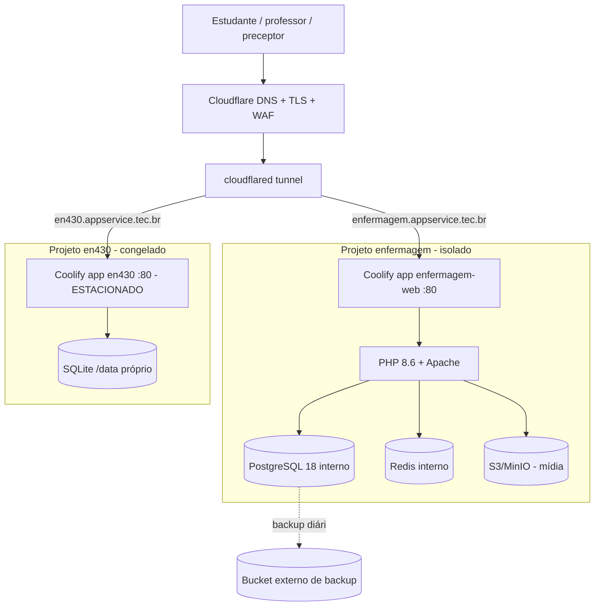

# 🏗️ Infraestrutura do Novo Projeto — `enfermagem.appservice.tec.br`

**Status:** 🟩 mock do novo projeto publicado em produção (G0-C parcial) · **Versão:** 1.3 · **Data:** 2026-11-23
**Owner:** Tech lead · **Aprovação:** Direção
**Documentos relacionados:** [PRD](PRD_APOIO_FORMACAO_TECNICA_ENFERMAGEM.md) ·
[Plano de expansão](EXPANSAO_CURSO_TECNICO_ENFERMAGEM.md) ·
[Controle do planejamento](PROGRESSO_PLANEJAMENTO.md) ·
[Auditoria do planejamento](../auditorias/AUDITORIA_PLANEJAMENTO_REFORMULACAO_2026-11-23.md)

> **Decisão de arquitetura (ADR-001):** o novo projeto roda em **infraestrutura isolada** —
> aplicação, banco, volume, segredos, backups e observabilidade próprios. O EN_430
> (`en430.appservice.tec.br`) é **estacionado**: permanece no ar, sem evolução, sem exclusão e
> **sem compartilhar** banco, volume, credenciais ou pipeline de deploy com o novo projeto.

---

## 1. Estado verificado (2026-11-23)

| Item | Verificação | Resultado |
|---|---|---|
| URL do novo projeto | `GET https://enfermagem.appservice.tec.br/` | **HTTP 200** — mock estático publicado (era 503 antes desta execução) |
| Projeto Coolify do novo produto | `coolify project get d7ldx6uqgsvdeal3u0kjk3lq` | **Criado**: `enfermagem` / ambiente `production` |
| Aplicação publicada | `coolify app get ey4wpwwencsnvj9xluoxnyjj` | `enfermagem-web` · `running:healthy` · build `static` |
| URL do projeto atual | `https://en430.appservice.tec.br` | **HTTP 200**, `running:healthy` — **inalterado** |
| Isolamento Coolify | Projetos `enfermagem` e `en430` separados | **Ativo** desde esta execução |
| Auto-deploy do EN_430 | `coolify app get 2iweyqxekxmminhiwgyv5bvk` | **Desativado** em 2026-11-23 (`is_auto_deploy_enabled=false`), etiqueta `estacionado`; app `running:healthy` e `GET /` = 200 |
| Banco do novo projeto | Não provisionado (o mock não usa banco) | Pendente para o G1 |
| Backups do novo projeto | Não existentes | Pendente para o G1 |

**Consequência:** o 503 de antes era o estado esperado de um host sem aplicação — não era falha
do EN_430. O mock agora ocupa esse hostname; o app antigo segue em seu próprio projeto, sem
compartilhar domínio, variável ou deploy.

---

## 2. Princípios de isolamento

| # | Regra | Motivo |
|:-:|---|---|
| I1 | Um **projeto Coolify** por produto (`enfermagem` e `en430`) | Evita deploy, variável e rollback cruzados |
| I2 | **Banco e volume exclusivos** do novo projeto | SQLite/PostgreSQL compartilhado corrompe e mistura dados de titulares |
| I3 | **Segredos exclusivos** (`APP_KEY`, `SECRET_KEY`, `ADMIN_SECRET`, `DATABASE_URL`) | Rotação e vazamento ficam contidos a um produto |
| I4 | **Nenhum deploy automático** no EN_430 durante a construção | Estacionar significa congelar, não apagar |
| I5 | **Domínios e rotas de túnel distintos** | Isolamento de borda e de logs |
| I6 | **Backups separados e testados** | Recuperação independente |
| I7 | Dados reais do EN_430 **não** migram para o novo ambiente sem base legal e transparência | Nova finalidade exige nova análise (LGPD) |

---

## 3. Arquitetura-alvo



| Componente | Escolha | Observação |
|---|---|---|
| Orquestração | Coolify (projeto `enfermagem`) | Mesma plataforma, **projeto separado** do `en430` |
| Aplicação | `enfermagem-web` — Dockerfile do repositório | PHP 8.6 + Apache; porta interna 80 |
| Banco | `enfermagem-db` — PostgreSQL 18 | **Sem porta pública**; acesso só pela rede interna |
| Cache/filas | `enfermagem-redis` | Sessões, cache e jobs |
| Mídia | S3 compatível (MinIO/Spaces) | Só quando houver vídeo/PDF próprio |
| Borda | Cloudflare (DNS, TLS, WAF, rate limit) + `cloudflared` | Regras de ingress separadas por hostname |
| Backups | `pg_dump` diário + retenção 30 dias + cópia externa | Teste de restauração mensal com evidência |

### 3.1 Compatibilidade da stack com o projeto anterior

**Pergunta:** é possível manter a stack de desenvolvimento do projeto anterior no novo projeto?
**Resposta:** sim, na família e no ferramental; o banco e o cache são **adições**, não trocas de
linguagem ou de framework.

| Camada | EN_430 hoje | Novo projeto | Mantém? | Ação necessária |
|--------|-------------|--------------|:-------:|-----------------|
| Linguagem | PHP 8.6 | PHP 8.6 | ✅ | Nenhuma; suporte de segurança até 2030 |
| Servidor web | Apache 2.4 + `.htaccess` | Apache 2.4 | ✅ | Manter o hardening já aplicado |
| Dependências | Composer | Composer | ✅ | Acrescentar `ext-pdo_pgsql` e, se houver Redis, `ext-redis` |
| Testes | PHPUnit 11 (180 testes / 469 asserções) | PHPUnit 11 | ✅ | Reaproveitar suíte e padrão de attributes |
| Container | Docker + Coolify | Docker + Coolify | ✅ | Projeto Coolify separado (`enfermagem`) |
| CI | GitHub Actions + Trivy | GitHub Actions + Trivy | ✅ | Incluir migração e testes no pipeline |
| Frontend | PHP renderizado + JS leve | PHP + JS leve + PWA | ✅ | PWA é acréscimo, não reescrita |
| Banco | SQLite em `/data` | PostgreSQL 18 | ⚠️ | **Não** reutilizar SQLite; instalar `pdo_pgsql`, escrever migrations e revisar SQL/dialeto |
| Sessão/cache | Arquivos do PHP | Redis (opcional no MVP) | ⚠️ | Instalar `ext-redis` e implementar handler; sem Redis, sessão em arquivo continua válida |
| Landing/mock | — | Build `static` (nginx) | ✅ | Separado do app; não interfere na stack PHP |
| Scripts operacionais | Python em `scripts/` | Python | ✅ | Mantidos como ferramentas de apoio |

**Conclusão verificada em 2026-11-23:**

1. A stack de **desenvolvimento** (PHP 8.6, Apache, Composer, PHPUnit 11, Docker, Git e Python de
   apoio) permanece a mesma; não há reescrita nem mudança de linguagem.
2. A stack de **execução** muda apenas no banco: PostgreSQL substitui o SQLite por requisito de
   concorrência, integridade e analytics. Isso exige `pdo_pgsql` — **ausente** na imagem atual — e
   migrations versionadas.
3. Redis é **opcional**: só entra se houver necessidade de sessão compartilhada, cache ou filas; a
   imagem atual também não traz `ext-redis`.
4. O build do mock é estático e não consome a stack PHP; a troca para o produto (G1) reutiliza o
   mesmo Dockerfile.

**Risco se o SQLite for mantido:** o novo escopo tem múltiplos papéis, turmas, estágio e relatórios
analíticos; o arquivo único do SQLite limita concorrência e escrita simultânea. A decisão de migrar
já está registrada no PRD (D4) e não muda a stack de desenvolvimento.

---

## 4. Provisionamento passo a passo

### 4.1 DNS e borda

1. Criar registro **A/AAAA** (ou CNAME para o túnel) `enfermagem` em `appservice.tec.br`.
2. Manter `en430` **intacto** — nenhuma alteração de DNS, rota ou certificado.
3. No túnel, adicionar **uma regra nova**:

```yaml
# ~/.cloudflared/config.yml (trecho de ingress)
ingress:
  - hostname: enfermagem.appservice.tec.br
    service: http://localhost:8081     # porta exclusiva do novo app
  - hostname: en430.appservice.tec.br
    service: http://localhost:8080     # inalterado
  - service: http_status:404
```

4. Ativar **Always Use HTTPS** no hostname novo (o que ficou pendente no EN_430, §8.5 do
   `ESTADO_ATUAL`, deve ser configurado para o novo projeto desde o início).
5. Rate limit de borda para `/login` e `/cadastro`; WAF gerenciado ligado.

> **Decisão de 2026-11-23 — subdomínio do Design System: adiado.** O mock de observação do Design
> System foi entregue como **subpágina** (`/design-system/`), porque criar
> `mock.enfermagem.appservice.tec.br` exige dois passos que dependem de credencial que o ambiente
> não tem: registro DNS na Cloudflare (sem token de API, conforme `ESTADO_ATUAL` §8.5) e regra de
> ingress no túnel (`/etc/cloudflared/config.yml`, que exige `sudo`). A subpágina não depende de DNS
> e já é servida pelo app `enfermagem-web` (base `/mockups`). Para promover a subdomínio depois,
> basta:
>
> 1. criar o CNAME `mock.enfermagem` → `<UUID>.cfargotunnel.com` (proxied) na Cloudflare;
> 2. acrescentar `https://mock.enfermagem.appservice.tec.br` à lista de FQDN do app e redeployar.
>
> Enquanto isso, `enfermagem.appservice.tec.br` e `en430.appservice.tec.br` permanecem **intactos**.

### 4.2 Coolify

0. **Executado (2026-11-23)** — estado real da instância `servitec-local`:

| Item | Valor |
|---|---|
| Projeto | `enfermagem` — `d7ldx6uqgsvdeal3u0kjk3lq` (ambiente `production` = `ljs09pobjjhnehbxsk9vqlch`) |
| Aplicação | `enfermagem-web` — `ey4wpwwencsnvj9xluoxnyjj` |
| Origem | `https://github.com/hsoservicos/en430.git`, branch `mock/landing-enfermagem` |
| Build pack | `static` (nginx), `base_directory` `/mockups` — **o mock é servido como raiz do site** |
| Porta interna | `80` |
| Domínio | `https://enfermagem.appservice.tec.br` |
| Health check | `GET /` → 200, intervalo 5s |
| Auto-deploy | Habilitado **apenas** para a branch do mock |
| Status | `running:healthy` |

Duas particularidades da instância foram resolvidas e devem ser lembradas:

- O build pack `static` copia **o diretório base inteiro** (`COPY . .`) e **ignora**
  `publish_directory`. Para publicar só o mock, `base_directory` aponta para `/mockups`.
- O túnel `cloudflared` entrega a origem por **HTTP** e reescreve `X-Forwarded-Proto`. Com o
  redirect de HTTPS do Traefik ativo na origem, o visitante entrava em **loop 307**. A correção é
  desligar *Force HTTPS* no app e redirecionar no nginx lendo **`CF-Visitor`** (mesma solução
  aplicada ao EN_430). O valor de `force_https`/`custom_labels` só muda com um novo deploy.

1. Criar **projeto** `enfermagem` (separado de `en430`). ✅ executado
2. Criar aplicação `enfermagem-web`:
   - **fase atual (mock):** build pack **static**, base directory `/mockups`, branch
     `mock/landing-enfermagem`;
   - **fase do produto (G1):** trocar para build pack **Dockerfile**, base directory `/`,
     branch `master`, volume `/data` próprio e banco `enfermagem-db`;
   - domínio `https://enfermagem.appservice.tec.br`, porta 80;
   - health check `GET /` → 200. ✅ executado
3. Criar serviço `enfermagem-db` (PostgreSQL 18) com **volume nomeado próprio**
   (`enfermagem_pgdata`) e sem porta publicada.
4. Criar serviço `enfermagem-redis` (sem persistência obrigatória; AOF opcional).
5. **Não** montar `/data` do EN_430 em nenhum serviço novo.
6. Marcar o app `en430` com a etiqueta `estacionado` e **remover o deploy automático** dele. — ✅
   executado em 2026-11-23 via `PATCH /api/v1/applications/2iweyqxekxmminhiwgyv5bvk`
   (`is_auto_deploy_enabled=false`) e etiqueta `estacionado`; o app permanece `running:healthy`.

### 4.3 Variáveis de ambiente (exclusivas do novo app)

```dotenv
APP_ENV=production
APP_URL=https://enfermagem.appservice.tec.br
APP_KEY=            # openssl rand -base64 32  (nunca versionar)
SECRET_KEY=         # openssl rand -base64 48
ADMIN_SECRET=       # openssl rand -base64 32  (sem fallback no código)
ADMIN_EMAIL=        # caixa institucional, não pessoal
DATABASE_URL=postgresql://enfermagem_app:<senha>@enfermagem-db:5432/enfermagem
REDIS_URL=redis://enfermagem-redis:6379
MAIL_TRANSPORT=log                # trocar só com provedor e DPA definidos
MAIL_FROM=nao-responder@enfermagem.appservice.tec.br
CONSENTIMENTO_VERSAO=1.0
TZ=America/Fortaleza
```

Regras: segredo **só** no Coolify; nenhum valor padrão no código (corrige A1/A2 da auditoria de
credenciais); rotacionar `APP_KEY`/`SECRET_KEY` invalida sessões — planejar janela.

### 4.4 Banco

```sql
CREATE ROLE enfermagem_app LOGIN PASSWORD '<senha-forte>';
CREATE DATABASE enfermagem OWNER enfermagem_app;
REVOKE ALL ON DATABASE enfermagem FROM PUBLIC;
-- extensões mínimas
CREATE EXTENSION IF NOT EXISTS pgcrypto;
CREATE EXTENSION IF NOT EXISTS unaccent;
```

- Migrações versionadas e idempotentes; `migrate --check` no pipeline.
- Conexões com `sslmode=require` na rede interna e `statement_timeout` definido.
- Nenhum `seed` com dados reais: apenas dados sintéticos de demonstração.

### 4.5 Placeholder público (para tirar o 503)

Enquanto o produto não existe, publicar a **landing page de apresentação** (mock aprovado) como
conteúdo estático com:

- `noindex` em `<meta name="robots">` (evita indexação de conteúdo provisório) — ✅ ativo;
- aviso visível de **material de apoio**, sem promessa de certificação — ✅ presente;
- link para `/politica-de-privacidade/` — ✅ publicado em 2026-11-23, com escopo do site de
  apresentação (sem cadastro, sem cookies próprios);
- health check respondendo 200 — ✅ `GET /` = 200.

**Estado publicado (2026-11-23):** <https://enfermagem.appservice.tec.br/> responde **200** com TLS
válido, `Strict-Transport-Security: max-age=31536000` e `http://` → **301** para `https://`.
O redirect de esquema é feito pelo nginx a partir de `CF-Visitor` (o TLS termina na Cloudflare).

---

## 5. Backup, restauração e continuidade

| Item | Definição |
|---|---|
| Banco | `pg_dump -Fc` diário às 03:00 (America/Fortaleza) |
| Retenção | 7 diários + 4 semanais + 12 mensais |
| Destino | Bucket externo, criptografado, credencial distinta do app |
| Verificação | `pg_restore --list` diário (automático) + restauração completa **mensal** |
| Evidência | Registro em `PROGRESSO_PLANEJAMENTO.md` com data, tamanho e tempo de restauração |
| RPO/RTO | RPO ≤ 24h; RTO ≤ 4h — **declarados por entidade** (progresso, notas, auditoria, estágio) |
| Rollback | Imagem anterior + snapshot do banco; ensaio obrigatório antes do G1 |

---

## 6. Observabilidade

| Sinal | Implementação | Alerta |
|---|---|---|
| Disponibilidade | Uptime externo em `/` e `/login` a cada 1 min | 2 falhas consecutivas |
| Latência | p95 por rota crítica (login, avaliação, painel) | p95 > 2 s por 10 min |
| Erros | Taxa de 5xx e exceções PHP no stderr | > 1% em 5 min |
| Banco | Conexões, disco, tempo de query lenta | > 80% de disco |
| Backup | Sucesso do dump e idade do último backup | > 26h sem backup |
| Segurança | Falhas de login por IP, 403/429 | Pico anômalo |

Logs estruturados (JSON) com `request_id`, sem PII; retenção conforme ROPA.

---

## 7. Critérios de aceite do G0-C

- [x] `https://enfermagem.appservice.tec.br/` responde **200** com TLS válido e HSTS.
- [x] `http://` redireciona para `https://` (redirect em `CF-Visitor` no nginx; *Always Use HTTPS*
      da zona continua desligado — vale ligar na Cloudflare).
- [ ] `enfermagem-db` **não** expõe porta à internet (`ss -ltn` no host não mostra 5432 público) —
      sem banco até o G1.
- [x] Nenhum serviço novo monta `/data` ou o volume do EN_430 (o mock não usa volume).
- [ ] Segredos gerados aleatoriamente, sem fallback no código; `git grep` não encontra valores —
      sem segredos nesta fase (site estático).
- [ ] Backup diário executado e **uma restauração completa validada** com data registrada — G1.
- [x] `en430.appservice.tec.br` continua **200** e inalterado; auto-deploy desativado em 2026-11-23.
- [x] Landing page com disclaimer e `noindex`; política publicada em `/politica-de-privacidade/`.
- [ ] Alertas de disponibilidade, erro e backup ativos e testados — G1.

---

## 8. Riscos

| Risco | Sev. | Mitigação |
|---|:--:|---|
| Rota do túnel apontar o hostname novo para o app antigo | **Alta** | Regra dedicada + verificação de `Server`/conteúdo + checklist |
| Reutilizar volume/banco do EN_430 "para economizar" | **Crítica** | Proibição explícita (I2) e verificação no checklist |
| Deploy automático no EN_430 durante a construção | Média | Congelar pipeline e documentar |
| Falha compartilhada do túnel/Cloudflare | Média | Aceitar no MVP; reavaliar instância separada no R1 |
| Custos de PostgreSQL/Redis/S3 sem teto | Média | Tabela de custo por cenário e alerta de gasto |
| Dados de estudantes do EN_430 migrados sem base legal | **Alta** | Não migrar; se necessário, análise jurídica e aviso prévio |

---

## 9. Cronograma

| Data | Entrega | Evidência |
|---|---|---|
| 2026-11-23 | Projeto `enfermagem` e app `enfermagem-web` criados; mock publicado | IDs `d7ldx6uqgsvdeal3u0kjk3lq` / `ey4wpwwencsnvj9xluoxnyjj`; `GET /` = 200 |
| 2026-11-30 | Variáveis e banco provisionados (G1) | Print/ID do Coolify |
| 2026-12-05 | Landing substituída pelo produto; 404 da política resolvido | `GET /` = 200 |
| 2026-12-08 | Backup + restauração validados; alertas ativos | Registro no controle |
| 2026-12-11 | G0-C aprovado | Checklist assinado |

---

## 10. Controle do documento

| Versão | Data | Autor | Alteração |
|:------:|------|-------|-----------|
| 1.0 | 2026-11-23 | Tech lead (auditoria) | Criação do plano de infraestrutura isolada do novo projeto |
| 1.1 | 2026-11-23 | Tech lead | Estado real: projeto/app Coolify criados, mock publicado com HTTPS/HSTS, correções de build `static` e do loop de redirect documentadas |
| 1.2 | 2026-11-23 | Tech lead | Política de Privacidade publicada no domínio novo; link do rodapé e checklist do G0-C atualizados |
| 1.3 | 2026-11-23 | Tech lead | Auto-deploy do EN_430 desativado e verificado; app segue saudável e URL em 200 |

*Cada passo é verificável e registrado no controle do planejamento.*
