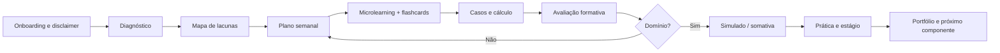

# 📘 PRD — Programa de Apoio à Formação Técnica em Enfermagem

**Status:** draft para aprovação da direção
**Versão:** 1.0
**Data:** 2026-11-21
**Owner:** Direção do projeto
**Produto:** plataforma de estudo, prática e evidências para apoio ao curso Técnico em Enfermagem
**Documentos relacionados:** [`ementa.md`](../ementa.md) · [`EXPANSAO_CURSO_TECNICO_ENFERMAGEM.md`](EXPANSAO_CURSO_TECNICO_ENFERMAGEM.md)

> **Natureza do produto:** material educacional de apoio. **Não é curso, não confere diploma,
> certificação profissional, créditos ou registro no COREN** e **não substitui** o PPC, o
> estágio supervisionado, as aulas práticas ou a avaliação da instituição de ensino.
> Em qualquer divergência, prevalecem o PPC institucional e a legislação vigente.

---

## 0. Controle do documento

| Versão | Data | Autor | Alteração |
|:------:|------|-------|-----------|
| 1.0 | 2026-11-21 | Direção do projeto | Primeira versão consolidada, com verificação de fontes oficiais |

**Aprovações necessárias:** Direção · Coordenação pedagógica · Enfermeiro responsável técnico · DPO/ Jurídico · Tech lead.

---

## 1. Sumário executivo

O projeto nasceu como **EN_430 — Introdução à Enfermagem (120h)** e hoje cobre apenas uma
disciplina introdutória. O curso Técnico em Enfermagem, porém, é uma formação de nível médio
com **1.200h mínimas de atividades teórico-práticas**, acrescidas de **estágio curricular
supervisionado definido no PPC** — a ementa do projeto adota **600h**, totalizando **1.800h
de referência** —, organizada em **4 módulos e 17 componentes**.

Este PRD define a evolução do produto para acompanhar o estudante **ao longo de todo o curso**,
como **material de apoio**, não como fonte nem fundamento da formalização, certificação ou
reconhecimento da formação. A proposta é:

- **Currículo rastreável:** 4 módulos, 17 componentes, unidades, competências e referências oficiais.
- **Banco de questões confiável:** 4.400 itens únicos, multi-tipo, revisados por pares e com análise psicométrica.
- **Aprendizagem ativa:** diagnóstico, plano de estudo, repetição espaçada, casos clínicos, simulados e feedback.
- **Prática e estágio:** checklists, OSCE, horas e portfólio — sem substituir a supervisão do enfermeiro.
- **Acesso:** PWA mobile-first, offline, acessível (WCAG 2.2 AA) e em português claro.
- **Governança:** papéis de aluno, professor, revisor, preceptor, coordenação e admin; auditoria e LGPD.
- **Sustentabilidade:** evoluir o monólito PHP + PostgreSQL existente, sem reescrever do zero.

**Meta de produto:** ser o companheiro de estudo de referência do estudante técnico em
Enfermagem, com conteúdo alinhado ao PPC e às normas oficiais, sem jamais se apresentar como
curso ou certificação.

**Prazo de referência:** ~11 meses, em 4 fases (Fundação, MVP, R1, R2), com o **conteúdo
autoral como caminho crítico**.

---

## 2. Contexto e oportunidade

### 2.1 O problema atual

O EN_430 entrega valor real, mas foi desenhado para uma disciplina:

| Dimensão | Situação atual | Consequência |
|----------|----------------|--------------|
| Cobertura | 10 módulos de Fundamentos | 1 componente majoritariamente pronto; 5 parciais; 11 sem conteúdo |
| Banco | 2.803 registros, ~495 enunciados únicos | ~82% de inflação por variações textuais |
| Tipos de item | apenas múltipla escolha A–D | não avalia cálculo, caso clínico, ordenação ou prática |
| Currículo | `modulo` inteiro 1–10 | impossível mapear PPC, horas e competências |
| Avaliação | 20 questões aleatórias | provas desbalanceadas, sem blueprint ou psicometria |
| Prática | nenhuma | estágio e OSCE fora da plataforma |
| Papéis | aluno + admin | sem professor, revisor, preceptor ou coordenação |
| Acessibilidade | não auditada | barreira legal e pedagógica |
| Dados | SQLite e JSON | analytics e integridade limitados |

### 2.2 A oportunidade

- O estudante técnico precisa de **material acessível, móvel e alinhado ao currículo**, muitas vezes estudando em intervalos curtos e com internet instável.
- Professores precisam de **autoria e revisão** com menos retrabalho.
- Coordenações precisam de **visão de cobertura** e de evidências de prática.
- O mercado oferece bancos de questões genéricos ou LMS complexos; falta um produto **focado no curso técnico de Enfermagem**, com rigor normativo e linguagem de apoio.

### 2.3 Terminologia correta

O curso Técnico em Enfermagem é **Educação Profissional Técnica de Nível Médio**, não
graduação. Ao longo deste documento, "formação técnica", "curso técnico" e "habilitação"
são usados nesse sentido. "Graduação" fica reservada ao nível superior (Enfermagem), que
**não** é coberto por este produto.

---

## 3. Problema e proposta de valor

**Problema:** o estudante do curso Técnico em Enfermagem não dispõe de um apoio digital
contínuo, curricularmente organizado e legalmente responsável que o acompanhe da introdução
até a prática supervisionada, com conteúdo confiável e avaliação formativa.

**Proposta de valor:** uma plataforma de apoio que responde a quatro perguntas:

1. **O que preciso estudar agora?** → mapa do curso + diagnóstico + plano semanal.
2. **Estou aprendendo de verdade?** → prática recuperativa, feedback e progresso por competência.
3. **Consigo aplicar em situações reais?** → casos clínicos, cálculo, simulados e checklists de prática.
4. **Onde estou em relação ao curso?** → cobertura, lacunas e evidências de estágio.

---

## 4. Visão, missão e princípios

**Visão:** todo estudante técnico em Enfermagem ter um companheiro de estudo confiável,
acessível e ético durante toda a formação.

**Missão:** transformar o currículo oficial em experiências de aprendizagem ativa, avaliação
formativa e evidências de prática, respeitando os limites legais e pedagógicos da formação.

### 4.1 Princípios de produto

1. **Apoio, não certificação.** O produto nunca promete diploma, crédito, aprovação ou registro.
2. **Fidelidade curricular.** O PPC é a fonte de verdade; o conteúdo é versionado e rastreável.
3. **Evidência antes de opinião.** Conteúdo baseado em fontes oficiais e científicas, com data e revisão.
4. **Aprendizagem ativa.** Recuperação, espaçamento, intercalação, casos e feedback — não apenas leitura.
5. **Segurança clínica e ética.** Casos fictícios, sem dados de pacientes, sem prescrição ou diagnóstico.
6. **Acessibilidade e inclusão.** WCAG 2.2 AA, linguagem simples, legendas, transcrições e navegação por teclado.
7. **Privacidade por padrão.** Minimização de dados, sem dados sensíveis de saúde, LGPD desde o design.
8. **IA com supervisão humana.** IA apenas como rascunho/apoio; revisão obrigatória e fontes citadas.
9. **Qualidade sobre quantidade.** 4.400 itens únicos valem mais que 20.000 variações.
10. **Operação sustentável.** Simplicidade técnica, custos previsíveis e manutenção possível.

### 4.2 O que sucesso significa

- O estudante sabe o que estudar e percebe progresso.
- O professor publica conteúdo revisado com menos esforço.
- A coordenação enxerga cobertura e lacunas.
- O preceptor registra prática com evidências.
- Nenhum usuário confunde o produto com o curso oficial.

### 4.3 Diferenciais modernos

| Diferencial | Como aparece no produto |
|-------------|-------------------------|
| **Aprendizagem baseada em competências** | Trilhas por competência, domínio e evidências, não só por aula |
| **Mastery learning** | O estudante avança quando demonstra domínio, com reforço donde errou |
| **Prática recuperativa e espaçamento** | Flashcards, quizzes curtos e revisão programada |
| **Casos e simulação** | Casos clínicos fictícios, cálculo e OSCE |
| **Mobile-first e offline** | PWA instalável, conteúdo em cache e fila de respostas |
| **Acessibilidade universal** | WCAG 2.2 AA, legendas, transcrições, Libras e desenho universal |
| **Analytics ético** | Progresso e qualidade de itens sem ranking público nem venda de dados |
| **IA responsável** | Tutoria socrática, rascunho assistido e revisão humana obrigatória |
| **Conteúdo vivo** | Versionamento, fontes datadas e vigilância normativa semestral |

---

## 5. Enquadramento legal, ético e limites do produto

### 5.1 Normas estruturantes

| Norma | O que estabelece | Uso no produto |
|-------|------------------|----------------|
| **LDB — Lei nº 9.394/1996** | Diretrizes da educação nacional; EPT de nível médio | Base do enquadramento educacional |
| **CNCT — Resolução CNE/CEB nº 2/2020** | 4ª edição do Catálogo Nacional de Cursos Técnicos; Técnico em Enfermagem com 1.200h mínimas | Referência de carga horária e perfil |
| **DCN EPT — Resolução CNE/CP nº 1/2021** | Diretrizes gerais da Educação Profissional e Tecnológica; revoga a Resolução CNE/CEB nº 6/2012 | Organização por competências e itinerários |
| **Lei nº 7.498/1986** | Exercício da Enfermagem; atribuições do técnico sob supervisão do enfermeiro | Limites de escopo do conteúdo e das práticas |
| **Decreto nº 94.406/1987** | Regulamenta a Lei nº 7.498/1986 | Detalhamento das atribuições |
| **Resolução COFEN nº 564/2017** | Código de Ética dos Profissionais de Enfermagem (CEPE) | Ética, sigilo, responsabilidade |
| **Resolução COFEN nº 736/2024** | Processo de Enfermagem em todo contexto de cuidado; revoga a Resolução COFEN nº 358/2009 | Fundamentos, SAE/PE e registro |
| **Resolução COFEN nº 609/2019** | Registro de especialização técnica de nível médio | Conteúdo de especialidades e educação continuada |
| **Parecer Normativo COFEN nº 001/2019** | Não há carga horária federal obrigatória de estágio; o PPC define | Parametrização do estágio |
| **Parecer COFEN nº 38/2026** | Entendimento: não há amparo para aproveitamento de estudos entre técnico e graduação | Reforço de que o produto não concede crédito/equivalência |
| **Parecer COFEN nº 19/2025** | EaD em saúde exige no mínimo 50% presencial, conforme sistema de ensino | Alerta para não sugerir formação a distância |
| **Lei nº 8.080/1990 e Lei nº 8.142/1990** | SUS, princípios, participação e financiamento | Conteúdo de Saúde Coletiva |
| **Lei nº 10.216/2001** | Proteção e direitos das pessoas com transtornos mentais; Reforma Psiquiátrica | Saúde Mental |
| **Portaria GM/MS nº 3.088/2011** | Rede de Atenção Psicossocial (RAPS) | Saúde Mental; **em revisão em 2026, monitorar** |
| **RDC ANVISA nº 36/2013** | Segurança do paciente e Núcleo de Segurança do Paciente | Biossegurança e qualidade |
| **RDC ANVISA nº 222/2018** | Boas práticas de gerenciamento de resíduos de serviços de saúde (PGRSS) | Biossegurança |
| **RDC ANVISA nº 15/2012** | Boas práticas para processamento de produtos para saúde (CME) | Centro Cirúrgico/CME |
| **NR-32** | Segurança e saúde no trabalho em serviços de saúde | Biossegurança e saúde do trabalhador |
| **Lei nº 13.709/2018 (LGPD)** | Proteção de dados pessoais | Privacidade e governança |
| **Lei nº 13.146/2015 (LBI)** | Inclusão da pessoa com deficiência | Acessibilidade |
| **Lei nº 8.069/1990 (ECA)** | Proteção integral de crianças e adolescentes | Estudantes menores e conteúdo sensível |
| **Lei nº 9.610/1998** | Direitos autorais | Licenciamento de conteúdo e mídia |

> **Nota de vigência:** a Resolução COFEN nº 564/2017 segue vigente em novembro de 2026. A
> minuta do novo Código de Ética foi aprovada em março de 2026 e aguarda publicação/entrada
> em vigor; o produto deve manter **alerta de transição** e revisar o conteúdo quando houver
> nova resolução. A RAPS também passa por revisão em 2026.

### 5.2 Carga horária e estágio: o que é nacional e o que é PPC

| Afirmação | Situação verificada | Fonte |
|-----------|---------------------|-------|
| O curso tem 1.200h mínimas | **Verdadeiro** — carga mínima nacional | CNCT / Res. CNE/CEB nº 2/2020 |
| O curso tem 600h de estágio obrigatórias em todo o Brasil | **Falso como regra federal** — o CNCT não fixa essa carga; o PPC/sistema de ensino define | CNCT; Parecer Normativo COFEN nº 001/2019 |
| O projeto adota 600h de estágio | **Verdadeiro como referência do projeto** — ementa e vários sistemas estaduais usam 600h | `docs/ementa.md`; práticas estaduais |
| O total de referência é 1.800h | **Verdadeiro apenas como referência** — 1.200h + 600h adotadas no projeto | Ementa do projeto |
| O curso é presencial ou EaD | **Depende do sistema de ensino**; se EaD, mínimo 50% presencial; se presencial, até 20% não presencial | CNCT; Parecer COFEN nº 19/2025 |

**Consequência de produto:** o estágio **não pode ser fixado em 600h no código**. A carga
deve ser **parametrizável por versão de PPC**, com 600h como valor padrão de referência.
O mesmo vale para a distribuição de horas dos componentes: a matriz da ementa é uma
**proposta de rateio**, não uma imposição nacional.

### 5.3 O que o produto é e o que não é

| É | Não é |
|---|-------|
| Material de apoio ao estudo e à avaliação formativa | Curso técnico, escola ou instituição de ensino |
| Recurso de aprofundamento e testagem | Diploma, certificado ou habilitação profissional |
| Apoio à organização do estágio e evidências | Substituição do estágio, da preceptoria ou do laboratório |
| Conteúdo alinhado ao PPC e às normas | Fonte oficial de currículo ou de registro profissional |
| Ferramenta de prática simulada | Dispositivo de diagnóstico, prescrição ou conduta clínica |
| Registro de progresso do estudante | Documento com validade legal ou acadêmica |

**Texto obrigatório de disclaimer (produto e exports):**

> Este é um material de apoio educacional. Não confere diploma, certificação, créditos,
> aprovação ou registro profissional. Não substitui o Projeto Pedagógico do Curso, o estágio
> supervisionado, as aulas práticas ou a avaliação da instituição. Casos clínicos são
> fictícios e não devem ser usados para decisões reais de cuidado.

### 5.4 Vedações explícitas

O produto **não deve**:

1. Emitir diploma, certificado de conclusão, certificado profissional ou "selo" de competência.
2. Conceder créditos, equivalência, aproveitamento de estudos ou dispensa de estágio.
3. Afirmar que o estudante está "formado", "habilitado" ou "registrado" no COREN.
4. Substituir avaliação institucional, banca, OSCE oficial ou supervisão de enfermeiro.
5. Coletar dados reais de pacientes, prontuários, exames ou imagens identificáveis.
6. Oferecer diagnóstico, prescrição, dose clínica individualizada ou conduta de urgência real.
7. Usar logotipos ou nomes de MEC, COFEN, COREN, ANVISA ou Ministério da Saúde sugerindo endosso.
8. Prometer aprovação em concurso, residência ou prova de classe.
9. Vender dados ou usar perfis para publicidade.
10. Publicar conteúdo gerado por IA sem revisão humana e fontes.

### 5.5 Ética, conteúdo sensível e integridade acadêmica

- Todo conteúdo assistencial é **fictício e desidentificado**; não há prontuário real.
- Casos de violência, suicídio, abuso, luto e saúde mental seguem linguagem cuidadosa, com
  avisos e encaminhamento para apoio quando necessário.
- Imagens de procedimentos e pacientes só com licença e consentimento; preferir ilustrações.
- O produto **não incentiva** realização de procedimentos invasivos por estudantes fora de
  ambiente supervisionado.
- A plataforma orienta o estudante a seguir o **CEPE**, o sigilo profissional e as normas da instituição.
- Denúncias de conteúdo inadequado têm canal e prazo de resposta.

### 5.6 LGPD e estudantes menores

- Coletar o mínimo: nome, e-mail, instituição, papel, preferências. **Não coletar CPF, dados de saúde ou biometria.**
- Menores de 18 anos: tratamento conforme ECA e LGPD, com transparência e, quando exigido,
  consentimento de responsável; interface adequada à faixa etária.
- Base legal documentada por finalidade; analytics agregado/pseudonimizado.
- Direitos do titular: acesso, correção, portabilidade, exclusão e revogação.
- Retenção: conta ativa + 24 meses; logs de auditoria conforme obrigação legal; exclusão
  mediante solicitação.
- DPO ou encarregado designado; canal de privacidade; registro de operações (ROPA).
- Fornecedores com contrato de tratamento de dados, subprocessadores e segurança.

### 5.7 Propriedade intelectual

- Conteúdo próprio com licença a definir (recomendação: **CC BY-NC-SA 4.0** para material
  educacional, ou licença institucional).
- Imagens, vídeos, tabelas e figuras de terceiros somente com licença compatível e crédito.
- Citação de normas e diretrizes é permitida; **reprodução integral de materiais protegidos não**.
- Conteúdo gerado por IA deve ser identificado e revisado; a responsabilidade editorial é humana.

### 5.8 Vigilância normativa (norm watch)

- Dono: coordenação pedagógica + enfermeiro responsável técnico.
- Cadência: revisão semestral e sempre que houver nova norma, diretriz ou calendário.
- Gatilhos: novo Código de Ética, atualização do CNCT/DCN, PNI, RAPS, RDC/ANVISA, NR-32,
  diretrizes de SBV/SAV, mudanças no PPC.
- Registro: changelog de conteúdo, data da última revisão e fonte primária.

---

## 6. Público e personas

| Persona | Contexto | Necessidades | Dores | Sucesso |
|---------|----------|--------------|-------|---------|
| **Estudante** | 16–45 anos, celular, internet instável, trabalha ou estuda em tempo integral | Saber o que estudar, praticar, medir progresso, entender erros | Conteúdo disperso, banco repetitivo, medo de prova, falta de tempo | Conclui unidades, melhora simulados, sente-se seguro |
| **Professor/autor** | Atua em componente específico | Criar, revisar e reutilizar itens e materiais | Retrabalho, falta de padrão, pouca visibilidade | Publica conteúdo revisado em menos tempo |
| **Revisor/enfermeiro** | Valida técnica e eticamente | Revisar itens, casos e checklists | Conteúdo desatualizado, fontes frágeis | Aprova com trilha de auditoria |
| **Preceptor** | Supervisiona estágio | Registrar horas, competências e evidências | Planilhas, papel, retrabalho | Valida checklist no celular |
| **Coordenação** | Responde pelo curso/PPC | Ver cobertura, desempenho e conformidade | Falta de dados, risco legal | Relatórios claros e acionáveis |
| **Admin/DPO/TI** | Opera a plataforma | Segurança, backup, LGPD, disponibilidade | Incidentes, custo, complexidade | Operação estável e auditável |

**Persona primária:** estudante. **Persona decisora:** coordenação/direção. **Persona de
qualidade:** revisor enfermeiro.

---

## 7. Objetivos e métricas de sucesso

### 7.1 Objetivos de produto (12 meses)

| ID | Objetivo | Resultado esperado |
|:--:|----------|--------------------|
| O1 | Cobertura curricular | 17/17 componentes com conteúdo e banco |
| O2 | Aprendizagem | Ganho pré/pós ≥ 20 p.p.; domínio ≥ 70% |
| O3 | Qualidade | 4.400 itens únicos, 100% revisados, KR-20 ≥ 0,70 |
| O4 | Acesso | PWA instalável, offline, WCAG 2.2 AA nas telas críticas |
| O5 | Confiança | 0 incidentes LGPD; 0 promessas de certificação; disclaimers 100% |

### 7.2 KPIs

| Categoria | KPI | Baseline | Meta |
|-----------|-----|:--------:|:----:|
| Cobertura | Componentes com conteúdo e banco | 1/17 | 17/17 |
| Cobertura | Unidades com ≥ 20 itens únicos | baixa | 100% |
| Conteúdo | Itens únicos | ~495 | 4.400 |
| Conteúdo | Duplicidade por variação | ~82% | < 5% |
| Conteúdo | Itens de aplicação/análise | baixa | ≥ 30% |
| Conteúdo | Itens com caso/mídia | 0 | ≥ 20% |
| Qualidade | Itens revisados por pares | 0 | 100% |
| Qualidade | KR-20 em provas somativas | não medido | ≥ 0,70 |
| Qualidade | Itens com discriminação ≥ 0,20 | não medido | ≥ 80% |
| Aprendizagem | Ganho pré/pós | não medido | ≥ 20 p.p. |
| Aprendizagem | Taxa de domínio por componente | não medido | ≥ 70% |
| Engajamento | Estudantes ativos semanais | não medido | ≥ 60% da turma |
| Engajamento | Conclusão de componente | não medido | ≥ 70% |
| Prática | Checklists validados por preceptor | 0 | 100% dos aplicáveis |
| Acessibilidade | Telas críticas WCAG 2.2 AA | 0 auditadas | 100% |
| Performance | p95 de páginas críticas | não medido | ≤ 2 s |
| Operação | Uptime | não medido | ≥ 99,5% |
| Privacidade | Incidentes LGPD | 0 | 0 |
| Suporte | Satisfação (CSAT) | não medido | ≥ 4,5/5 |

### 7.3 Guardrails

- Nenhuma tela pode sugerir certificação, habilitação ou endosso oficial.
- Nenhum dado de paciente pode entrar no ambiente de estudo.
- Nenhum conteúdo de IA pode ser publicado sem revisão humana.
- Nenhum aluno pode ser ranqueado publicamente por desempenho.
- Nenhum anúncio ou venda de dados.

---

## 8. Escopo

### 8.1 Dentro do escopo

**Conteúdo e currículo**

- 4 módulos, 17 componentes, unidades e competências.
- 4.400 itens únicos, multi-tipo, com metadados e revisão.
- 88 materiais/unidades de estudo (leitura, caso, resumo, flashcards, mídia).
- Referências oficiais e data de revisão em cada unidade.

**Aprendizagem**

- Diagnóstico inicial e mapa de lacunas.
- Plano semanal e trilha adaptativa baseada em regras.
- Repetição espaçada (SM-2 ou equivalente).
- Casos clínicos, cálculo de medicamentos e simulados.
- Feedback explicativo, caderno de erros e progresso por competência.

**Avaliação**

- Blueprints, banco sorteado, múltiplos tipos de item.
- Análise psicométrica (p-value, discriminação, KR-20).
- Avaliação formativa, somativa e simulados.
- Acessibilidade e acomodações.

**Prática e estágio**

- Checklist de procedimentos, rubricas e OSCE.
- Registro de horas, portfólio e parecer do preceptor.
- Campos: UBS/ESF, clínica médica/cirúrgica, materno-infantil, urgência/UTI e, opcionalmente, CAPS.
- Carga de estágio parametrizável (padrão 600h de referência).

**Gestão**

- Papéis e permissões; turmas; autoria e revisão.
- Relatórios de cobertura, turma e qualidade.
- Auditoria, LGPD, backup e observabilidade.

### 8.2 Fora do escopo

- Curso, certificação, diploma, crédito, aproveitamento ou registro profissional.
- Substituição de estágio, laboratório, preceptoria ou avaliação institucional.
- Diagnóstico, prescrição ou telemedicina.
- App nativo (iOS/Android) na primeira fase.
- Marketplace, pagamentos e assinatura na primeira fase.
- Multi-instituição e white-label na primeira fase.
- LMS completo, fórum amplo ou rede social.
- IA autônoma que crie ou aprove conteúdo sem humano.
- Conteúdo de graduação em Enfermagem.
- Dados reais de pacientes.

### 8.3 Premissas

- Existe uma instituição/PPC de referência ou a direção assume a ementa como referência.
- Há time autoral de professores/enfermeiros para revisão.
- Estudantes têm smartphone e acesso intermitente à internet.
- O produto será oferecido em português do Brasil.
- O produto pode operar sem integração oficial com MEC/COFEN/COREN.

### 8.4 Restrições

- Conteúdo é o caminho crítico; software não compensa conteúdo fraco.
- Orçamento e equipe limitados; fases com critérios de saída.
- Normas e diretrizes mudam; necessidade de revisão contínua.
- LGPD, ECA e acessibilidade não são opcionais.
- Nenhum endosso oficial pode ser presumido.

---

## 9. Arquitetura curricular

### 9.1 Estrutura de referência

| Módulo | Componentes | CH proposta | Itens-alvo |
|--------|-------------|:-----------:|:----------:|
| **I — Fundamentos Básicos e Saúde Coletiva** | Anatomia e Fisiologia; Microbiologia e Parasitologia; Biossegurança/CCIH; SUS; Ética/Bioética/Legislação; Psicologia/Humanização | 300h | 1.350 |
| **II — Bases Técnicas e Clínica Geral** | Fundamentos/Semiotécnica; Farmacologia/Cálculo; Nutrição/Dietética; Clínica Médica | 330h | 1.200 |
| **III — Cirúrgica e Ciclos de Vida** | Cirúrgica/CC/CME; Saúde da Mulher; Criança/Adolescente/Neonatologia; Saúde do Idoso | 330h | 1.150 |
| **IV — Alta Complexidade** | Urgência/Emergência; UTI; Saúde Mental | 240h | 700 |
| **Estágio** | 4 campos + CAPS opcional | 600h (ref.) | 150 evidências |

**Total de referência:** 1.200h teórico-práticas + 600h de estágio = 1.800h; 17 componentes; 4.400 itens.

> A distribuição de horas e itens é uma **proposta de planejamento**. O PPC prevalece e o
> produto deve permitir outra distribuição sem alterar o código.

### 9.2 Competências e rastreabilidade

Cada componente deve declarar:

- **Competência geral** (o que o estudante deve ser capaz de fazer).
- **Unidades** com objetivos de aprendizagem observáveis.
- **Pré-requisitos** e progressão entre módulos.
- **Referências oficiais** e científicas.
- **Evidências** (item, caso, checklist, OSCE, projeto).

**Cadeia de rastreabilidade:**

```
PPC/versão → Módulo → Componente → Unidade → Objetivo → Conteúdo → Item → Avaliação → Evidência
```

O produto deve exibir, para cada item e material, **de qual unidade/competência ele veio**.

### 9.3 Perfil de saída (referência CNCT)

O egresso deve apoiar o enfermeiro em:

- promoção, prevenção, recuperação e reabilitação da saúde;
- cuidados integrais ao paciente e à família;
- biossegurança e controle de infecção;
- administração de medicamentos e vacinas;
- curativos, sinais vitais e registros;
- segurança do paciente e trabalho em equipe;
- atuação em UBS, clínica, cirúrgica, materno-infantil, urgência/UTI e saúde mental.

O produto **apoia** essas competências; não as certifica.

### 9.4 Priorização de conteúdo

| Fase | Componentes | Itens | Justificativa |
|------|-------------|:-----:|---------------|
| **MVP** | Fundamentos, Farmacologia, Biossegurança, Ética | 1.100 | Reaproveitamento e base transversal |
| **R1** | + Anatomia, SUS, Clínica Médica | +900 (2.000) | Completa a base e a clínica geral |
| **R2** | + 10 componentes restantes | +2.400 (4.400) | Cobertura integral e prática |

### 9.5 Temas-núcleo e fontes por componente

| Componente | Temas-núcleo | Fontes e órgãos de referência |
|------------|--------------|-------------------------------|
| Anatomia e Fisiologia | Células, tecidos, sistemas tegumentar, esquelético, muscular, nervoso, endócrino, cardiovascular, respiratório, digestório, urinário e reprodutor | Literatura científica; MS |
| Microbiologia e Parasitologia | Bactérias, vírus, fungos, parasitas, transmissão, microbiota | ANVISA; MS; NR-32 |
| Biossegurança e CCIH | Precauções, EPI/EPC, higiene das mãos, PGRSS, limpeza/desinfecção/esterilização | RDC 222/2018; RDC 15/2012; RDC 36/2013; NR-32 |
| SUS e Saúde Coletiva | História, Leis 8.080/90 e 8.142/90, princípios, APS/ESF, redes | MS; CNS |
| Ética, Bioética e Legislação | Lei 7.498/86, Decreto 94.406/87, CEPE, atribuições, sigilo, responsabilidade | COFEN/COREN; Parecer 38/2026 |
| Psicologia e Humanização | PNH, relação profissional-paciente-família, adoecimento, dor e luto | MS (PNH) |
| Fundamentos e Semiotécnica | SSVV, exame físico, higiene, mobilidade, LPP, O2, sondas, curativos, coleta, registros | COFEN 736/2024; MS |
| Farmacologia e Cálculo | Farmacocinética, vias, "certos", diluição, gotejamento, classes e reações | ANVISA; MS; protocolos de segurança |
| Nutrição e Dietética | Macronutrientes, dietas terapêuticas, TNE/TNP | MS; ANVISA |
| Clínica Médica | HAS, IC, IAM, AVE, DPOC, asma, pneumonias, TB, DM, tireoide, IRA/IRC, diálise, hemorragias, hepatites, cirrose | MS; sociedades científicas |
| Cirúrgica, CC e CME | Pré, trans e pós-operatório, SRPA, Aldrete, drenos, CME | RDC 15/2012; RDC 36/2013; NR-32 |
| Saúde da Mulher | Planejamento reprodutivo, pré-natal, parto, puerpério, amamentação, urgências obstétricas | MS; Lei 11.108/2005 |
| Criança, Adolescente e Neonatologia | RN na sala de parto, triagens, crescimento, PNI, doenças prevalentes, adolescência | ECA; MS; PNI |
| Saúde do Idoso | Senescência/senilidade, síndromes geriátricas, demências, quedas, cuidados paliativos, polifarmácia | Estatuto da Pessoa Idosa; MS |
| Urgência e Emergência | SBV/SAV, PCR/RCP, classificação de risco, trauma, queimados, intoxicações, choques | AHA 2025; MS; protocolo local |
| UTI | Monitorização, ventilação mecânica, drogas vasoativas, balanço hídrico, PAV | AMIB; MS; ANVISA |
| Saúde Mental | Reforma Psiquiátrica, RAPS/CAPS, transtornos, crises, contenção, prevenção ao suicídio | Lei 10.216/2001; Portaria 3.088/2011 |
| Estágio (600h ref.) | UBS/ESF, clínica médica/cirúrgica, materno-infantil, urgência/UTI, CAPS opcional | PPC; instituição; preceptoria enfermeira |

---

## 10. Experiência do estudante

### 10.1 Jornada



### 10.2 Funcionalidades do estudante

| Área | Funcionalidade | Descrição |
|------|----------------|-----------|
| Orientação | Mapa do curso | Visão dos 4 módulos, 17 componentes e progresso |
| Orientação | Diagnóstico | 20–30 itens por componente, com mapa de lacunas |
| Orientação | Plano semanal | Agenda de estudo ajustada ao tempo disponível |
| Estudo | Microlearning | Unidades de 10–15 min com objetivo, conteúdo e checagem |
| Estudo | Flashcards | Repetição espaçada e revisão de erros |
| Estudo | Casos clínicos | Raciocínio, priorização e conduta de enfermagem |
| Estudo | Cálculo | Dosagem, diluição, gotejamento e regra de três |
| Prática | Simulados | Blueprint, tempo e feedback por competência |
| Prática | Caderno de erros | Explicação, reincidência e revisão |
| Prática | OSCE/checklists | Preparação e evidências de prática |
| Progresso | Painel | Domínio, cobertura, sequência e conquistas |
| Acesso | Offline/PWA | Cache de conteúdo e fila de respostas |
| Acesso | Acessibilidade | Teclado, leitor de tela, contraste, legendas, transcrições |

### 10.3 Regras de experiência

- O estudante pode estudar sem diagnóstico, mas recebe recomendação para fazê-lo.
- Nenhuma funcionalidade bloqueia o acesso ao conteúdo por paywall na primeira fase.
- O progresso é privado; rankings só com opt-in e sem exposição de notas.
- O estudante pode exportar seus dados e resultados.
- O estudante pode denunciar conteúdo e sugerir correção.
- O produto nunca promete aprovação; comunica "prática" e "progresso".

---

## 11. Conteúdo e autoria

### 11.1 Modelo de conteúdo

- Fonte única em Markdown/MDX versionado, com metadados:
  `componente`, `unidade`, `objetivo`, `competência`, `carga`, `nível Bloom`, `referências`,
  `autor`, `revisor`, `data de revisão`, `licença`, `status`.
- Build gera HTML acessível e PDF; o app consome os mesmos artefatos.
- Cada unidade contém: objetivo, por que importa, conceitos, exemplo/caso, checagem,
  resumo, referências e "próximo passo".
- Glossário e siglas padronizados; linguagem simples e direta.

### 11.2 Pipeline editorial

```
Briefing → Rascunho → Revisão técnica (enfermeiro) → Revisão pedagógica →
Piloto com itens → Ajuste → Publicação → Revisão semestral
```

**Regras:**

- Nenhum conteúdo publicado sem **duas revisões** (técnica e pedagógica).
- Toda afirmação normativa cita a fonte e a data.
- Conteúdo com risco clínico passa por revisor enfermeiro com registro ativo.
- Mudança de norma gera tarefa de revisão e novo versionamento.
- Conteúdo de IA é rascunho, nunca publicação direta.

### 11.3 Padrão de itens

- Enunciado com contexto claro, sem pegadinha ou dupla negação.
- Alternativas homogêneas, uma correta inequívoca, distratores plausíveis.
- Feedback que explica o raciocínio, não apenas "errado".
- Metadados obrigatórios: componente, unidade, competência, Bloom, dificuldade, fonte,
  autor, revisor, status, versão.
- Itens com caso clínico usam dados fictícios e não identificáveis.
- Itens de cálculo incluem unidade, arredondamento e conferência.
- Revisão de linguagem, viés e sensibilidade cultural.

### 11.4 Mídia e acessibilidade

- Imagens com `alt` descritivo; gráficos com descrição textual.
- Vídeos com legenda, transcrição e, quando possível, Libras.
- Tabelas com cabeçalhos e leitura linear.
- PDFs acessíveis e versão HTML.
- Contraste e tipografia adequados; nada essencial apenas por cor.

### 11.5 Licenciamento e fontes

- Prioridade: legislação, MEC/CNE, MS, ANVISA, COFEN/COREN, MTE, OMS/OPAS.
- Secundário: sociedades científicas, artigos revisados por pares, diretrizes nacionais.
- Evitar blogs, resumos de terceiros e conteúdo sem autoria.
- Registrar licença de cada mídia e restrições de uso.
- Não copiar questões de provas de terceiros sem autorização.

### 11.6 Política de IA

**Permitido:** rascunhar explicações, gerar variações de itens para revisão, resumir fontes,
traduzir, revisar clareza, sugerir distratores, apoiar tutoria socrática.

**Proibido:** publicar sem revisão humana; gerar conduta clínica final; usar dados de
estudantes/pacientes em provedores sem base legal; reproduzir conteúdo protegido; criar
"especialista" que substitua professor.

**Guardrails:** rótulo "conteúdo assistido por IA", citação de fontes, avaliação de
qualidade, logs, revisão por amostragem, opt-out e contrato com o provedor.

---

## 12. Avaliação e integridade

### 12.1 Tipos de avaliação

| Tipo | Uso | Formato | Frequência |
|------|-----|---------|------------|
| Diagnóstico | Mapear lacunas | 20–30 itens por componente | Entrada |
| Formativa | Praticar e feedback | 5–10 itens por unidade | Contínua |
| Somativa | Fechar componente | 30–40 itens por blueprint | Fim do componente |
| Simulado | Preparar para provas | 60–100 itens, cronometrado | Quinzenal/mensal |
| OSCE | Validar técnica/comunicação | Estações com rubrica | Por prática |
| Portfólio | Evidências de estágio | Relatos, checklists, horas | Contínuo |

### 12.2 Blueprints

- Distribuição por unidade, dificuldade, Bloom e competência.
- Nenhuma unidade relevante sem item.
- Cada prova tem especificação publicada e resultado auditável.
- Itens novos entram com exposição controlada; itens ruins são aposentados.

### 12.3 Psicometria

- **p-value** (dificuldade), **discriminação** (ponto-bisserial), **KR-20/alfa**.
- Análise por item, turma e coorte; alertas de exposição e redundância.
- Itens com discriminação < 0,20 entram em revisão.
- Relatórios para professores, não rankings públicos.

### 12.4 Integridade

- Sorteio por blueprint, ordem e alternativas embaralhadas.
- Limite de tentativas e janela de aplicação.
- Detecção de padrões anômalos e revisão humana.
- **Não** usar vigilância invasiva (câmera, biometria, gravação) sem base legal e consentimento.
- Como não há certificação, o risco de fraude é menor; o foco é aprendizagem honesta.
- Código de conduta e orientação sobre uso de IA em atividades.

### 12.5 Acomodações

- Tempo adicional, contraste, fonte ampliada, leitor de tela, navegação por teclado.
- Pausas e ambiente silencioso quando aplicável.
- Alternativas para itens com mídia.
- Registro de acomodação sem estigma.

### 12.6 Prática e estágio

- Checklists com critérios observáveis e rubrica (insuficiente/em desenvolvimento/competente).
- OSCE com estações, atores/ simuladores e avaliador treinado.
- Registro de horas com validação do preceptor.
- Portfólio com reflexão, evidência e parecer.
- **Nenhum** checklist substitui a avaliação oficial da instituição.
- **Nenhum** dado de paciente real é armazenado; fotos e relatos são desidentificados.

---

## 13. Professores, coordenação e preceptores

### 13.1 Professor/autor

- Criar e versionar unidades, itens e casos.
- Submeter à revisão; acompanhar status.
- Montar turmas, atribuir trilhas e simulados.
- Ver desempenho por competência e item.
- Exportar relatórios (CSV/PDF).
- Sugerir correções com trilha de auditoria.

### 13.2 Coordenação

- Configurar versão do PPC, componentes, horas e pré-requisitos.
- Acompanhar cobertura e lacunas.
- Ver relatórios de turma, qualidade e estágio.
- Gerenciar papéis e permissões.
- Auditar mudanças e aprovar publicação.

### 13.3 Preceptor

- Registrar horas e checklists no celular.
- Avaliar competências com rubrica.
- Anexar evidências desidentificadas.
- Dar parecer e devolver ao estudante.
- Ver pendências e histórico.

### 13.4 Permissões (RBAC)

| Papel | Conteúdo | Avaliação | Turma | Estágio | Admin |
|-------|:--------:|:---------:|:-----:|:-------:|:-----:|
| Estudante | ler | responder | própria | próprio | — |
| Professor | criar/revisar | criar/corrigir | sim | acompanhar | — |
| Revisor | revisar/aprovar | revisar | — | — | — |
| Preceptor | ler | avaliar prática | acompanhar | validar | — |
| Coordenação | aprovar | aprovar | sim | sim | relatórios |
| Admin | — | — | — | — | total |
| DPO | — | — | — | — | auditoria/LGPD |

---

## 14. Requisitos funcionais

**Prioridade:** P0 = obrigatório no MVP; P1 = R1; P2 = R2.

### 14.1 Confiança e conformidade

| ID | Requisito | Pri. | Critério de aceite |
|----|-----------|:----:|--------------------|
| FR-01 | Exibir disclaimer de apoio educacional | P0 | Visível no onboarding, rodapé, avaliações e exports; texto aprovado por jurídico |
| FR-02 | Não emitir certificado/diploma/crédito | P0 | Nenhuma funcionalidade ou texto promete certificação; teste de revisão de conteúdo |
| FR-03 | Registrar aceite de termos e privacidade | P0 | Consentimento versionado, com data e opção de revogação |
| FR-04 | Canal de denúncia de conteúdo | P0 | Formulário autenticado, protocolo e prazo de resposta |
| FR-05 | Exibir fonte e data de revisão | P0 | Cada unidade/item mostra referência e última revisão |

### 14.2 Currículo e conteúdo

| ID | Requisito | Pri. | Critério de aceite |
|----|-----------|:----:|--------------------|
| FR-06 | Versionar PPC e matriz curricular | P0 | Criar/clonar/comparar versões; componentes, horas e pré-requisitos |
| FR-07 | Modelar 4 módulos e 17 componentes | P0 | Seed da ementa com horas e itens-alvo; edição sem código |
| FR-08 | Rastrear componente → unidade → objetivo → item | P0 | Navegação e relatório de cobertura |
| FR-09 | Configurar carga de estágio por PPC | P0 | Campo parametrizável; padrão 600h; sem hard-code |
| FR-10 | Publicar conteúdo em Markdown/MDX | P1 | Pipeline gera HTML/PDF acessível; versionamento |
| FR-11 | Autoria com fluxo de revisão | P1 | Estados rascunho → revisão → aprovado → publicado; auditoria |
| FR-12 | Banco multi-tipo | P1 | Múltipla escolha, múltipla resposta, cálculo, ordenação, caso |
| FR-13 | Metadados obrigatórios de item | P1 | Bloqueia publicação sem componente, Bloom, dificuldade, fonte e revisor |

### 14.3 Aprendizagem

| ID | Requisito | Pri. | Critério de aceite |
|----|-----------|:----:|--------------------|
| FR-14 | Diagnóstico por componente | P1 | 20–30 itens; relatório de lacunas por unidade |
| FR-15 | Plano semanal | P1 | Gera agenda a partir de lacunas e tempo disponível; editável |
| FR-16 | Repetição espaçada | P1 | Fila diária; intervalo ajustado ao acerto; exportável |
| FR-17 | Casos clínicos | P1 | Caso fictício, decisões, feedback e referência |
| FR-18 | Calculadora de doses educacional | P2 | Passo a passo, validação e aviso "não usar em paciente real" |
| FR-19 | Caderno de erros | P2 | Lista erros, explicação, reincidência e revisão |
| FR-20 | Painel de progresso | P0 | Domínio por componente/competência; privado por padrão |

### 14.4 Avaliação

| ID | Requisito | Pri. | Critério de aceite |
|----|-----------|:----:|--------------------|
| FR-21 | Gerar avaliação por blueprint | P1 | Distribuição configurável; nenhuma unidade crítica ausente |
| FR-22 | Corrigir e explicar | P1 | Nota, feedback por alternativa e referência |
| FR-23 | Simulado cronometrado | P1 | Tempo, pausa, revisão e resultado por competência |
| FR-24 | Análise psicométrica | P2 | p-value, discriminação, KR-20; exportável |
| FR-25 | Acomodações de acessibilidade | P1 | Tempo/fonte/contraste/teclado configuráveis |
| FR-26 | Antiabuso sem vigilância invasiva | P1 | Sorteio, tentativas e detecção de padrão; sem câmera/biometria |

### 14.5 Prática e estágio

| ID | Requisito | Pri. | Critério de aceite |
|----|-----------|:----:|--------------------|
| FR-27 | Checklist de procedimentos | P1 | Itens observáveis, rubrica e assinatura do preceptor |
| FR-28 | Registro de horas | P1 | Soma por campo; validação; exportação |
| FR-29 | Portfólio | P2 | Relato, evidência desidentificada, parecer e histórico |
| FR-30 | OSCE | P2 | Estações, rubrica, avaliador e resultado |
| FR-31 | Relatório de estágio | P2 | Horas, competências, pendências e parecer |

### 14.6 Gestão, dados e operação

| ID | Requisito | Pri. | Critério de aceite |
|----|-----------|:----:|--------------------|
| FR-32 | Papéis e turmas | P0 | RBAC; convite; vínculo; menor privilégio |
| FR-33 | Relatórios de cobertura | P1 | Componentes/unidades com conteúdo e itens; lacunas |
| FR-34 | Relatórios de turma | P1 | Desempenho agregado; sem ranking público |
| FR-35 | Exportação de dados | P0 | CSV/PDF; dados do titular; prazo |
| FR-36 | Exclusão/anonimização | P0 | Fluxo autenticado; auditoria; prazo |
| FR-37 | Auditoria | P0 | Quem, quando, o quê, antes/depois |
| FR-38 | PWA offline | P1 | Cache de conteúdo visitado; fila de respostas; sincronização |
| FR-39 | Acessibilidade | P0 | WCAG 2.2 AA nas telas críticas; testes com leitor de tela |
| FR-40 | IA assistida | P2 | Rótulo, fonte, revisão humana e bloqueio de PII |

---

## 15. Requisitos não funcionais

| ID | Requisito | Meta |
|----|-----------|------|
| NFR-01 | Desempenho | p95 ≤ 2 s em 3G; LCP ≤ 2,5 s |
| NFR-02 | Disponibilidade | ≥ 99,5% mensal |
| NFR-03 | Escala | 5.000 estudantes; 500 concorrentes |
| NFR-04 | Segurança | OWASP ASVS L2; CSP; rate limit; 2FA para staff |
| NFR-05 | Privacidade | LGPD; minimização; ROPA; DPIA quando necessário |
| NFR-06 | Acessibilidade | WCAG 2.2 AA; eMAG; teclado; leitor de tela |
| NFR-07 | Compatibilidade | Chrome, Firefox, Safari, Edge; Android/iOS atuais |
| NFR-08 | Offline | Conteúdo visitado disponível; sincronização idempotente |
| NFR-09 | Observabilidade | Logs estruturados, métricas, alertas, uptime |
| NFR-10 | Backup | Diário; retenção 30 dias; teste mensal de restauração |
| NFR-11 | RPO/RTO | RPO ≤ 24h; RTO ≤ 4h |
| NFR-12 | Manutenibilidade | Migrações versionadas; testes; documentação; ADRs |
| NFR-13 | Internacionalização | PT-BR; estrutura para espanhol no futuro |
| NFR-14 | Sustentabilidade | Custos previsíveis; monitoramento de uso de IA |

---

## 16. Dados, analytics e privacidade

### 16.1 Entidades principais

`cursos`, `ppc_versions`, `componentes`, `unidades`, `objetivos`, `conteudos`, `questoes`,
`alternativas`, `tags`, `blueprints`, `avaliacoes`, `avaliacao_questao`, `respostas`,
`usuarios`, `matriculas`, `turmas`, `papeis`, `progresso`, `estagios`, `checklists`,
`evidencias`, `auditoria`.

### 16.2 Eventos de aprendizagem

- início/fim de unidade; resposta; tempo; tentativa; feedback visto.
- diagnóstico concluído; plano criado/ajustado; revisão espaçada.
- simulado concluído; erro reincidente; domínio atualizado.
- checklist/OSCE validado; horas registradas.
- denúncia/ correção; consentimento; exportação/exclusão.

### 16.3 Ética analítica

- Métricas agregadas e pseudonimizadas; acesso restrito.
- Sem publicidade, sem venda, sem perfilamento comercial.
- Sem inferência de saúde mental ou condição clínica do estudante.
- Estudante pode optar por não participar de analytics não essencial.
- Relatórios para professores usam dados da turma, não exposição individual pública.

### 16.4 Retenção e descarte

| Dado | Retenção | Descarte |
|------|----------|----------|
| Conta e perfil | ativo + 24 meses | anonimizar/excluir |
| Respostas e progresso | enquanto conta ativa | excluir com conta |
| Logs de auditoria | 5 anos ou obrigação legal | anonimizar |
| Consentimentos | enquanto necessário | manter prova legal |
| Conteúdo de estágio | enquanto necessário | excluir/anonimizar |

---

## 17. Dependências e integrações

### 17.1 Dependências institucionais

| Dependência | Dono | Impacto | Mitigação |
|-------------|------|---------|-----------|
| PPC e matriz oficial | Coordenação | Fonte de verdade | Versionar; validar na fase 0 |
| Campos de estágio e preceptores | Instituição | Prática | Mapear parceiros; plano B |
| Calendário acadêmico | Coordenação | Trilhas e turmas | Configurável |
| Política de avaliação | Coordenação | Notas e aprovação | Produto não decide aprovação |
| Base legal para menores | Jurídico/DPO | LGPD/ECA | Consentimento e transparência |

### 17.2 Dependências regulatórias

| Órgão | Papel | Relação com o produto |
|-------|-------|-----------------------|
| MEC/CNE | CNCT, DCN EPT | Referência curricular; **sem endosso** |
| Conselho Estadual de Educação | Autorização do curso | Fora do escopo; produto não é curso |
| COFEN/COREN | Exercício, ética, fiscalização | Referência de escopo; **sem endosso** |
| ANVISA | Biossegurança, resíduos, segurança do paciente | Referência de conteúdo |
| Ministério da Saúde | SUS, PNI, RAPS, PNH | Referência de conteúdo |
| MTE | NR-32, NR-1/PGR | Referência de biossegurança |
| ANPD | LGPD | Conformidade |

> **Não é dependência:** aprovação prévia do MEC/COFEN para um material de apoio; integração
> com SISTEC; integração com COREN. O produto não substitui esses sistemas.

### 17.3 Dependências técnicas

| Categoria | Necessidade | Observação |
|-----------|-------------|------------|
| Banco | PostgreSQL 18 | Produção; SQLite só dev/teste |
| Hospedagem | Docker/Coolify | Staging e produção |
| Mídia | Object storage S3 compatível | Vídeos, imagens, PDFs |
| Cache/filas | Redis | Sessões, jobs e relatórios |
| E-mail | Provedor transacional | Com DPA e opt-in |
| IA | Provedor com DPA | Sem treinar com dados; opt-out |
| SSO | Google/Microsoft (opcional) | R1/R2 |
| Integração LMS | LTI 1.3 (opcional) | R2; não no MVP |

---

## 18. Roadmap e releases

### 18.1 Fases

| Fase | Duração | Escopo | Critério de saída |
|------|:-------:|--------|-------------------|
| **0. Fundação** | 4 semanas | Governança, PPC, jurídico, taxonomia, padrões, baseline, ADR | Matriz e disclaimers aprovados; donos nomeados |
| **MVP** | 12 semanas | Fundamentos, Farmacologia, Biossegurança, Ética; 1.100 itens; diagnóstico/formativa; PWA; autoria; LGPD/ACESS. básica | 4 componentes publicados; 100% itens revisados; WCAG nas telas críticas |
| **R1** | 12 semanas | + Anatomia, SUS, Clínica Médica; 2.000 itens; somativa/simulados; checklists de estágio (piloto); analytics; SSO | 7 componentes; KR-20 ≥ 0,70 no piloto; 2 campos de estágio |
| **R2** | 16 semanas | + 10 componentes; 4.400 itens; OSCE/portfólio; adaptativo; IA beta; Libras; relatórios completos | 17/17 componentes; 4.400 itens; auditoria de acessibilidade |
| **R3. Operação** | contínuo | Norm watch, psicometria, revisões, suporte, expansão | Revisão semestral e SLA |

**Total:** ~44 semanas (~11 meses), com conteúdo como caminho crítico.

> **Relação com o plano técnico:** este PRD refina o recorte de releases. O plano mantém a
> arquitetura, a matriz e o roadmap macro; aqui o MVP é reduzido a 4 componentes para validar
> pedagogia e o R1 incorpora Clínica Médica (7 no total). Se a direção preferir o recorte
> original de 6 componentes, basta mover Clínica Médica para o R2 — o modelo de dados e o
> produto não mudam.

### 18.2 Entregas por release

**MVP**

- Onboarding com disclaimer e termos.
- Mapa do curso (4 módulos/17 componentes, 4 ativos).
- Diagnóstico e plano semanal.
- Unidades, flashcards, casos e cálculo.
- Avaliação formativa com feedback.
- Painel do estudante.
- Autoria e revisão.
- Admin, papéis, auditoria e LGPD básica.
- PWA offline e acessibilidade baseline.

**R1**

- Somativas e simulados com blueprint.
- Relatórios de turma e cobertura.
- Checklists de estágio (UBS e clínica).
- SSO opcional.
- Psicometria inicial.

**R2**

- 17 componentes e 4.400 itens.
- OSCE e portfólio.
- Repetição espaçada adaptativa.
- IA tutora beta com guardrails.
- Libras e legendas ampliadas.
- Relatórios de qualidade e estágio completos.

### 18.3 Equipe e esforço

| Papel | Alocação | Observação |
|-------|----------|------------|
| Product owner | 50% | Direção/coordenação |
| Líder pedagógico | 100% | Conteúdo e formação de autores |
| Tech lead | 50% | Arquitetura e revisão |
| Desenvolvedor backend | 100% | PHP/PostgreSQL |
| Desenvolvedor frontend/PWA | 100% | Acessibilidade e offline |
| Designer/UX | 60% | Jornadas e design system |
| QA/automação | 40% | Testes e acessibilidade |
| Professores-autores | 8 × 10h/semana | 1.800–2.600h de conteúdo |
| Revisores enfermeiros | 4 × 5h/semana | Revisão técnica e ética |
| DPO/Jurídico | 10% | LGPD, termos, propriedade intelectual |
| Consultoria de acessibilidade | 20% | Auditoria e correções |
| Articulação de estágio | 10% | Campos e preceptores |

**Custo:** orçar por pessoa-mês + custo autoral + acessibilidade + jurídico + infraestrutura.
O conteúdo é o maior e mais crítico custo.

### 18.4 Gates de decisão

- **G0:** PPC/ementa e disclaimers aprovados; base legal revisada.
- **G1:** MVP com 4 componentes e 1.100 itens revisados; teste com 1 turma.
- **G2:** R1 com 7 componentes e 2.000 itens; KR-20 ≥ 0,70; 2 campos de estágio.
- **G3:** R2 com 17 componentes e 4.400 itens; auditoria de acessibilidade; plano de sustentação.

---

## 19. Riscos e mitigação

| Risco | Prob. | Impacto | Mitigação | Dono |
|-------|:-----:|:-------:|-----------|------|
| Produto ser confundido com curso/certificação | Média | Alto | Disclaimer em todas as telas; revisão jurídica; comunicação | Direção |
| Conteúdo desatualizado | Alta | Alto | Norm watch; revisão semestral; fontes datadas | Coordenação |
| Conteúdo autoral não acompanhar o software | Alta | Alto | Contratar autores antes; metas por componente | Direção |
| Itens de baixa qualidade | Média | Alto | Revisão por pares; piloto; psicometria; aposentadoria | Líder pedagógico |
| Estágio sem campos/convênios | Média | Alto | Mapear na fase 0; parcerias; checklist sem prometer estágio | Articulação |
| LGPD/menores | Média | Alto | Minimização; consentimento; DPIA; DPO | DPO |
| IA gerar conteúdo incorreto | Média | Alto | Rascunho + revisão humana + fontes | Tech lead |
| Acessibilidade tratada tarde | Alta | Médio | Requisitos desde o MVP; auditoria em cada release | Designer |
| Adoção baixa | Média | Médio | Piloto, treinamento, UX simples, suporte | Product owner |
| Escopo crescer para LMS | Alta | Médio | Não-objetivos; gate mensal; backlog disciplinado | Product owner |
| Custo acima do previsto | Média | Médio | Fases com critérios de saída; orçamento por gate | Direção |
| Dependência de uma pessoa | Média | Alto | Documentação, pareamento, CI, ADRs | Tech lead |
| Conteúdo de terceiros sem licença | Média | Alto | Checklist de licença; preferir próprios/CC | Jurídico |
| Incidente de segurança | Baixa | Alto | ASVS, pentest, backups, resposta a incidentes | TI |

---

## 20. Critérios de aceite e Definition of Done

### 20.1 Release

- [ ] Escopo da release concluído e testado.
- [ ] Checklist legal: disclaimers, termos, privacidade, licenças.
- [ ] Checklist de acessibilidade nas telas críticas.
- [ ] Checklist de segurança e LGPD.
- [ ] Migrações e rollback testados.
- [ ] Backup e restauração validados.
- [ ] Monitoramento e alertas ativos.
- [ ] Changelog e documentação atualizados.

### 20.2 Conteúdo

- [ ] Objetivo e competência declarados.
- [ ] Fontes oficiais/científicas citadas e datadas.
- [ ] Revisão técnica por enfermeiro e pedagógica.
- [ ] Linguagem revisada e acessível.
- [ ] Mídia com licença, alt e transcrição.
- [ ] Itens com metadados completos e feedback.
- [ ] Nenhuma promessa de certificação ou conduta clínica real.

### 20.3 Feature

- [ ] Critérios de aceite atendidos.
- [ ] Testes automatizados relevantes.
- [ ] Acessibilidade por teclado e leitor de tela.
- [ ] Eventos de analytics definidos.
- [ ] Feature flag e rollback.
- [ ] Documentação e suporte.

### 20.4 Sinais de que o produto falhou

- Usuários acreditam que o produto certifica ou substitui o curso.
- Conteúdo sem fonte ou desatualizado.
- Itens duplicados ou com erro técnico.
- Barreiras de acessibilidade.
- Vazamento ou uso indevido de dados.
- Baixa adoção por complexidade.

---

## 21. Decisões e questões abertas

### 21.1 Decisões propostas

| ID | Decisão | Justificativa |
|:--:|---------|---------------|
| D1 | Produto é apoio, não certificação | Limite legal e ético |
| D2 | 600h de estágio é referência parametrizável | CNCT não fixa; PPC define |
| D3 | 17 componentes e 4.400 itens | Cobertura integral com qualidade |
| D4 | Evoluir PHP + PostgreSQL | Preserva investimento e história |
| D5 | PWA mobile-first | Alcance e custo |
| D6 | IA com revisão humana | Risco de conteúdo incorreto |
| D7 | MVP com 4 componentes | Reduz risco e valida pedagogia |
| D8 | Sem certificado na primeira fase | Evita confusão legal |
| D9 | Single-tenant no MVP | Simplicidade operacional |
| D10 | Licença de conteúdo a definir | Decisão jurídica/institucional |

### 21.2 Questões abertas

| ID | Questão | Dono | Prazo |
|:--:|---------|------|-------|
| Q1 | Qual PPC/instituição será a referência oficial? | Direção | Fase 0 |
| Q2 | O produto será gratuito, institucional ou misto? | Direção | Fase 0 |
| Q3 | Qual licença para o conteúdo próprio? | Jurídico | Fase 0 |
| Q4 | Haverá SSO/LTI no R1? | Tech lead | Fase 1 |
| Q5 | Qual provedor de IA e com que DPA? | Tech lead/DPO | R2 |
| Q6 | Como será a validação de conteúdo por enfermeiros? | Coordenação | Fase 0 |
| Q7 | Quais campos de estágio no piloto? | Articulação | R1 |
| Q8 | Haverá relatório de horas com validade institucional? | Coordenação | R1 |

---

## 22. Aprovação

| Área | Nome | Assinatura | Data |
|------|------|------------|------|
| Direção do projeto | | | |
| Coordenação pedagógica | | | |
| Enfermeiro responsável técnico | | | |
| DPO/Jurídico | | | |
| Tech lead | | | |

---

## 23. Referências oficiais

> Acesso em 2026-11-21. Normas podem ser alteradas; a revisão é semestral.

### Educação profissional

- **LDB — Lei nº 9.394/1996:** <https://www.planalto.gov.br/ccivil_03/leis/l9394.htm>
- **Lei nº 11.741/2008:** <https://www.planalto.gov.br/ccivil_03/_ato2007-2010/2008/lei/l11741.htm>
- **CNCT — Resolução CNE/CEB nº 2/2020:** <https://www.in.gov.br/en/web/dou/-/resolucao-n-2-de-15-de-dezembro-de-2020-294347656>
- **CNCT — Técnico em Enfermagem:** <https://cnct.mec.gov.br/cursos/curso?id=6>
- **DCN EPT — Resolução CNE/CP nº 1/2021:** <https://www.in.gov.br/en/web/dou/-/resolucao-cne/cp-n-1-de-5-de-janeiro-de-2021-297767578>
- **Catálogos MEC:** <https://www.gov.br/mec/pt-br/cne/normas-classificadas-por-assunto/catalogos>

### Exercício profissional e ética

- **Lei nº 7.498/1986:** <https://www.planalto.gov.br/ccivil_03/leis/l7498.htm>
- **Decreto nº 94.406/1987:** <https://www.planalto.gov.br/ccivil_03/decreto/1980-1989/D94406.htm>
- **Resolução COFEN nº 564/2017 (CEPE):** <https://www.cofen.gov.br/resolucao-cofen-no-5642017_59145.html>
- **Resolução COFEN nº 736/2024 (Processo de Enfermagem):** <https://www.in.gov.br/web/dou/-/resolucao-cofen-n-736-de-17-de-janeiro-de-2024-539060363>
- **Resolução COFEN nº 609/2019 (especialização técnica):** <https://www.cofen.gov.br/wp-content/uploads/2019/07/Resolucao-609-2019.pdf>
- **Parecer Normativo COFEN nº 001/2019 (estágio):** <https://www.cofen.gov.br/wp-content/uploads/2019/07/PARECER-NORMATIVO-01-2019.pdf>
- **Parecer COFEN nº 38/2026 (aproveitamento técnico → graduação):** <https://www.cofen.gov.br/wp-content/uploads/2026/06/Parecer-no-38-2026-Camaras-Tecnicas-de-Enfermagem.pdf>
- **Parecer COFEN nº 19/2025 (EaD e 50% presencial):** <https://www.cofen.gov.br/wp-content/uploads/2025/06/Parecer-no-19-2025-COFEN-CAMTEC-CTEPIENF.pdf>
- **COFEN — II Conferência Nacional de Ética (2026):** <https://biblioteca.cofen.gov.br/conferencia-nacional-aprova-minuta-do-novo-codigo-de-etica-de-enfermagem>

### Saúde, biossegurança e políticas

- **Lei nº 8.080/1990:** <https://www.planalto.gov.br/ccivil_03/leis/l8080.htm>
- **Lei nº 8.142/1990:** <https://www.planalto.gov.br/ccivil_03/leis/l8142.htm>
- **Lei nº 10.216/2001:** <https://www.planalto.gov.br/ccivil_03/leis/leis_2001/l10216.htm>
- **Lei nº 11.108/2005 (acompanhante no parto):** <https://www.planalto.gov.br/ccivil_03/_ato2004-2006/2005/lei/l11108.htm>
- **Lei nº 10.741/2003 (Estatuto da Pessoa Idosa):** <https://www.planalto.gov.br/ccivil_03/leis/2003/l10.741.htm>
- **Portaria GM/MS nº 3.088/2011 (RAPS):** <https://bvsms.saude.gov.br/bvs/saudelegis/gm/2011/prt3088_23_12_2011_rep.html>
- **RDC ANVISA nº 36/2013 (segurança do paciente):** <https://www.gov.br/anvisa/pt-br/assuntos/servicosdesaude/seguranca-do-paciente/legislacao>
- **RDC ANVISA nº 222/2018 (PGRSS):** <https://www.in.gov.br/en/web/dou/-/resolucao-rdc-n-222-de-28-de-marco-de-2018-8436194>
- **RDC ANVISA nº 15/2012 (CME):** <https://bvsms.saude.gov.br/bvs/saudelegis/anvisa/2012/rdc0015_15_03_2012.html>
- **NR-32:** <https://www.gov.br/trabalho-e-emprego/pt-br/acesso-a-informacao/participacao-social/conselhos-e-orgaos-colegiados/comissao-tripartite-partitaria-permanente/normas-regulamentadora/normas-regulamentadoras-vigentes/norma-regulamentadora-no-32-nr-32>
- **Ministério da Saúde — Diretrizes para Formação Técnica em Enfermagem (2024):** <https://www.gov.br/saude/pt-br/composicao/sgtes/diretrizes-para-formacao-tecnica-na-saude/publicacoes/tecnico-em-enfermagem>
- **PNI — Imunização:** <https://www.gov.br/saude/pt-br/assuntos/saude-de-a-a-z/i/imunizacao>
- **PNH — Política Nacional de Humanização:** <https://www.gov.br/saude/pt-br/assuntos/saude-de-a-a-z/p/politica-nacional-de-humanizacao>
- **AHA 2025 — CPR and ECC Guidelines:** <https://cpr.heart.org/en/resuscitation-science/cpr-and-ecc-guidelines>

### Direito digital, acessibilidade e proteção

- **LGPD — Lei nº 13.709/2018:** <https://www.planalto.gov.br/ccivil_03/_ato2015-2018/2018/lei/l13709.htm>
- **LBI — Lei nº 13.146/2015:** <https://www.planalto.gov.br/ccivil_03/_ato2015-2018/2015/lei/l13146.htm>
- **ECA — Lei nº 8.069/1990:** <https://www.planalto.gov.br/ccivil_03/leis/l8069.htm>
- **Lei de Direitos Autorais — Lei nº 9.610/1998:** <https://www.planalto.gov.br/ccivil_03/leis/l9610.htm>
- **WCAG 2.2:** <https://www.w3.org/TR/WCAG22/>
- **eMAG:** <https://emag.governoeletronico.gov.br/>
- **OWASP ASVS:** <https://owasp.org/www-project-application-security-verification-standard/>

---

## Apêndice A — Matriz de verificação normativa

| Afirmação | Status | Fonte primária | Ação no produto |
|-----------|:------:|----------------|-----------------|
| Curso técnico tem 1.200h mínimas | ✅ | CNCT | Cobertura e carga de referência |
| Estágio de 600h é obrigatório nacionalmente | ❌ | CNCT; Parecer 001/2019 | Parametrizar por PPC |
| Projeto adota 600h de referência | ✅ | Ementa | Padrão configurável |
| EaD exige 50% presencial | ✅ | CNCT; Parecer 19/2025 | Não sugerir formação EaD |
| Técnico atua sob supervisão do enfermeiro | ✅ | Lei 7.498/86; Decreto 94.406/87 | Limites de conteúdo e prática |
| CEPE vigente é a Resolução 564/2017 | ✅ (em transição) | COFEN | Monitorar novo código |
| Processo de Enfermagem é regido pela Res. 736/2024 | ✅ | COFEN | Atualizar Fundamentos/SAE |
| Entendimento do COFEN: sem amparo para aproveitamento técnico → graduação | ✅ | Parecer 38/2026 | Não conceder crédito/equivalência |
| Resíduos seguem RDC 222/2018 | ✅ | ANVISA | Atualizar Biossegurança |
| CME segue RDC 15/2012 | ✅ | ANVISA | Atualizar Cirúrgica/CME |
| Segurança do paciente segue RDC 36/2013 | ✅ | ANVISA | Atualizar qualidade |
| NR-32 é a referência de biossegurança | ✅ | MTE | Atualizar Biossegurança |
| RAPS é regulada pela Portaria 3.088/2011 | ✅ (em revisão) | MS | Monitorar revisão de 2026 |
| SBV/SAV seguem AHA 2025 | ✅ | AHA | Atualizar Urgência |
| Manchester é norma federal | ❌ | — | Tratar como protocolo do serviço |

## Apêndice B — Glossário

| Termo | Significado |
|-------|-------------|
| **CNCT** | Catálogo Nacional de Cursos Técnicos |
| **DCN EPT** | Diretrizes Curriculares Nacionais da Educação Profissional e Tecnológica |
| **PPC** | Projeto Pedagógico do Curso |
| **SISTEC** | Sistema Nacional de Informações da Educação Profissional e Tecnológica |
| **CEPE** | Código de Ética dos Profissionais de Enfermagem |
| **PE/SAE** | Processo de Enfermagem / Sistematização da Assistência de Enfermagem |
| **OSCE** | Objective Structured Clinical Examination (exame clínico objetivo estruturado) |
| **PGRSS** | Plano de Gerenciamento de Resíduos de Serviços de Saúde |
| **RAPS** | Rede de Atenção Psicossocial |
| **CAPS** | Centro de Atenção Psicossocial |
| **SBV/SAV** | Suporte Básico de Vida / Suporte Avançado de Vida |
| **KR-20** | Kuder-Richardson 20, medida de confiabilidade |
| **WCAG** | Web Content Accessibility Guidelines |
| **LGPD** | Lei Geral de Proteção de Dados Pessoais |

---

*Documento de produto para discussão e aprovação. Não substitui o PPC, a legislação vigente
nem a avaliação da instituição de ensino.*
